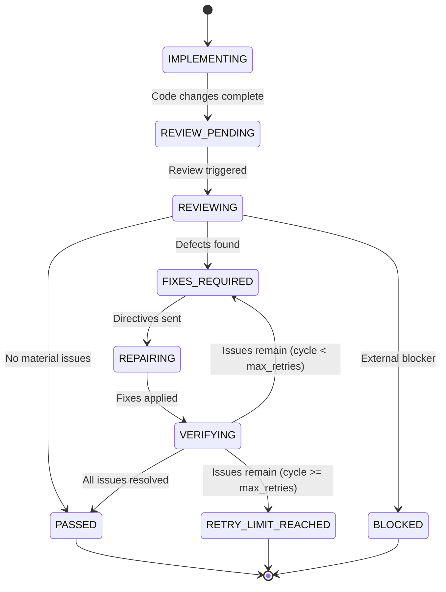

# SUPERVISOR State Machine & Loop Control

## Lifecycle States

SUPERVISOR enforces an explicit finite state machine with 9 defined states:

1. `IMPLEMENTING`: Coding agent is performing the task.
2. `REVIEW_PENDING`: Implementation step concluded; review trigger queued.
3. `REVIEWING`: SUPERVISOR is actively inspecting changes and running checks.
4. `FIXES_REQUIRED`: Material issues found; repair directives prepared.
5. `REPAIRING`: Coding agent is applying fixes without human intervention.
6. `VERIFYING`: SUPERVISOR is validating corrections against previous findings and regressions.
7. `PASSED`: Verification passed; no material issues remain.
8. `BLOCKED`: External factor (missing permission, unavailable dependency) halts progress.
9. `RETRY_LIMIT_REACHED`: Configured retry limit reached with unresolved issues.

## Loop Protection
- Default `max_retries`: 3.
- Incremented only upon post-repair verification.
- Findings are tracked by immutable Finding IDs across cycles to prevent duplicate reporting and infinite cycling.
