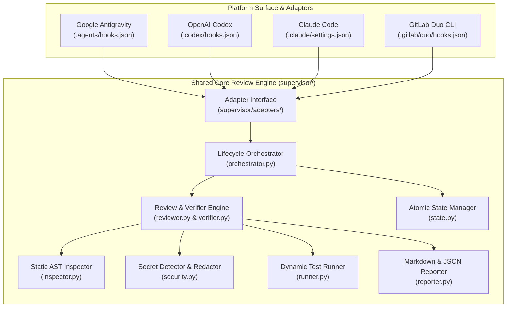
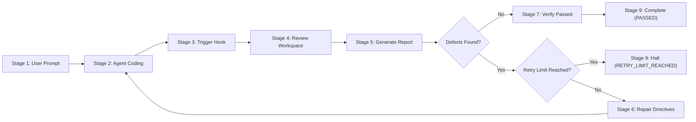

# SUPERVISOR: AI Coding Supervision & Automatic Repair System

[](LICENSE)
[](pyproject.toml)
[](tests/)

**SUPERVISOR** is an autonomous supervision and closed-loop repair engine designed for AI coding agents. It intercepts agent completion events, runs deterministic AST analysis, dynamic tests, security audits, and regression checks, and injects actionable repair directives directly back into agent context when material defects are identified.

> **The Core Mandate**: A coding task is not complete merely because an AI agent finished generating code. It is complete only when SUPERVISOR has rigorously reviewed the implementation, executed test suites, and verified the outcome—or transparently reported why verification could not be completed.

---

## Table of Contents

1. [Problem Statement](#1-problem-statement)
2. [Goals & Non-Goals](#2-goals--non-goals)
3. [Key Features](#3-key-features)
4. [Architecture & Execution Flow](#4-architecture--execution-flow)
5. [The Review, Repair & Verification Lifecycle](#5-the-review-repair--verification-lifecycle)
6. [Supported Platforms & Validation Status](#6-supported-platforms--validation-status)
7. [System Requirements](#7-system-requirements)
8. [Installation & Setup](#8-installation--setup)
9. [Platform Configurations](#9-platform-configurations)
10. [CLI Commands & Usage Examples](#10-cli-commands--usage-examples)
11. [Automatic Supervision vs. Manual Invocation](#11-automatic-supervision-vs-manual-invocation)
12. [Verification & Report-Only Behavior](#12-verification--report-only-behavior)
13. [Testing Instructions](#13-testing-instructions)
14. [Security Considerations](#14-security-considerations)
15. [Troubleshooting](#15-troubleshooting)
16. [Contribution Instructions](#16-contribution-instructions)
17. [License](#17-license)

---

## 1. Problem Statement

Modern AI coding agents (such as Google Antigravity, OpenAI Codex, Claude Code, and GitLab Duo) frequently declare completion as soon as their text generation finishes or basic files are edited. In practice, this results in:
- Unchecked syntax errors, broken imports, or missing dependencies.
- Silent regressions where existing passing tests are broken by new edits.
- Leaked credentials, API keys, or private keys introduced during rapid prototyping.
- "Premature victory" where agents assert that code works without ever executing test suites.
- Human user fatigue caused by manually catching obvious bugs and prompting the agent again to fix them.

SUPERVISOR bridges the gap between subjective model generation and objective software quality gates by implementing a deterministic, automated supervision and repair loop.

---

## 2. Goals & Non-Goals

### Goals
- **Objective Quality Gate**: Provide a deterministic review engine executing AST checks, dynamic test runners, and security pattern detection.
- **Closed-Loop Automatic Repair**: Intercept agent completion hooks to automatically return concrete, structured defect findings to the agent so it repairs issues without waiting for human intervention.
- **Cross-Platform Decoupling**: Maintain one shared review core with lightweight platform adapters for Antigravity, Codex, Claude Code, and GitLab Duo.
- **Zero External Runtime Dependencies**: Standard-library-only Python implementation (`>=3.9`) that runs anywhere without requiring external packages or network services.
- **Loop & Budget Safety**: Strictly enforce cycle limits (`max_retries`) and atomic session persistence to prevent runaway execution or infinite repair loops.

### Non-Goals
- **Replacing the Coding Agent**: SUPERVISOR is not a code generator; it supervises existing coding agents.
- **Guaranteeing Bug-Free Software**: SUPERVISOR proves the presence of defects and verifies concrete evidence; passing checks do not guarantee the absence of unknown logical bugs outside the test suite.
- **Fabricating Test Success**: If workspace tests are absent, failing, or require external databases, SUPERVISOR never fabricates a passing status; it explicitly marks tests as unverified or failed.

---

## 3. Key Features

- **Static AST & Structure Auditing**: Parses Python Abstract Syntax Trees to catch syntax errors, unresolved symbols, broken imports, and invalid TOML/JSON configuration files before execution.
- **Dynamic Test Execution & Regression Tracking**: Automatically discovers and runs workspace unit test suites with process timeouts, tracking previous failures and detecting newly introduced regressions.
- **Secret Detection & Evidence Redaction**: Scans staged and modified code for exposed API keys, bearer tokens, and private keys, while automatically redacting sensitive credentials from generated reports and agent prompts.
- **Actionable Repair Directives**: Converts raw failures into structured directives (defect location, evidence, severity, and suggested correction) formatted specifically for coding-agent prompt injection.
- **Atomic State Persistence**: Writes lifecycle session state atomically to `.supervisor/session_state.json` with cycle counting and task ID stability.
- **Cross-Platform Hook Integration**: Provides drop-in hook configurations and persistent instructions for Google Antigravity, OpenAI Codex, Claude Code, and GitLab Duo CLI.

---

## 4. Architecture & Execution Flow

SUPERVISOR strictly separates platform-specific hook adapters from the shared, platform-independent review engine:



---

## 5. The Review, Repair & Verification Lifecycle

SUPERVISOR implements a formal 9-stage lifecycle:



### Lifecycle State Machine

| Lifecycle State | Description |
| :--- | :--- |
| `IMPLEMENTING` | The coding agent is actively writing or modifying code to satisfy the user request. |
| `REVIEW_PENDING` | The agent signaled completion; a platform Stop hook or invocation triggered SUPERVISOR. |
| `REVIEWING` | SUPERVISOR parses ASTs, checks security, executes tests, and audits git diffs. |
| `FIXES_REQUIRED` | Material defects (Critical, High, or Medium severity) found; repair handoff directives created. |
| `REPAIRING` | Directives injected into agent context; the agent fixes code autonomously without human prompts. |
| `VERIFYING` | SUPERVISOR evaluates repairs, checks that previous defects are resolved, and watches for regressions. |
| `PASSED` | All verification checks pass with concrete evidence; task concludes successfully. |
| `BLOCKED` | External prerequisites missing (e.g. required system dependency or missing environment). |
| `RETRY_LIMIT_REACHED` | Maximum retry cycles exhausted while material defects remain unresolved. |

---

## 6. Supported Platforms & Validation Status

SUPERVISOR provides targeted adapters and hook configurations for four platforms. In accordance with honest disclosure principles:

| Platform | Integration Method | Automatic Repair Loop | Tested Validation Status |
| :--- | :--- | :--- | :--- |
| **Google Antigravity** | `Stop` hook (`.agents/hooks.json`), skill (`/supervisor`), workspace rules (`GEMINI.md`, `AGENTS.md`) | `{"decision": "continue", "reason": "<directives>"}` | **Validated in Live Desktop Host & Unit/E2E Suites** |
| **OpenAI Codex** | `Stop` hook (`.codex/hooks.json`), repo instructions (`AGENTS.md`), CLI loop harness | `decision: continue` + CLI stdin directives | **Validated via Unmocked Subprocess Fixtures & Unit Suites** |
| **Claude Code** | `Stop` hook (`.claude/settings.json`), custom slash command (`.claude/commands/supervisor.md`), rules (`CLAUDE.md`) | `decision: continue` + REVISE prompt handoff | **Validated via Unmocked Subprocess Fixtures & Unit Suites** |
| **GitLab Duo CLI** | `Stop` hook (`.gitlab/duo/hooks.json`), custom slash command (`.gitlab/duo/commands/supervisor.md`), rules (`.gitlab/duo/chat-rules.md`) | `decision: continue` + Duo CLI prompt handoff | **Validated via Unmocked Subprocess Fixtures & Unit Suites** |

*Note: Live desktop / cloud host testing for OpenAI Codex, Claude Code, and GitLab Duo requires active platform accounts and subscription environments. Full end-to-end integration is validated locally using realistic unmocked subprocess fixtures simulating each platform's lifecycle protocol, exit codes, and environment variables.*

---

## 7. System Requirements

- **Python**: Version 3.9 or higher (standard library only; Python 3.11+ provides built-in `tomllib`, older versions gracefully skip TOML linting).
- **Operating System**: Linux, macOS, or Windows (Windows 10/11 fully supported with PowerShell and CMD path handling).
- **Git**: Git 2.20+ installed and available in PATH (for diff inspection and revision tracking).
- **Dependencies**: **Zero third-party package dependencies**.

---

## 8. Installation & Setup

### Option A: Direct Execution (No Installation Required)

Because SUPERVISOR uses only the standard library, you can run it directly from the cloned repository:

```bash
git clone https://github.com/boredom198/supervisor.git
cd supervisor
python -m supervisor --help
```

### Option B: Editable Pip Installation

To expose the `supervisor` CLI command system-wide in your Python environment:

```bash
git clone https://github.com/boredom198/supervisor.git
cd supervisor
pip install -e .
supervisor --help
```

---

## 9. Platform Configurations

SUPERVISOR includes pre-built platform configuration files ready for your workspace:

### 1. Google Antigravity
- **Hook**: `.agents/hooks.json` intercepts `model_stop` and returns actionable directives when defects exist.
- **Skill**: `.agents/skills/supervisor/SKILL.md` provides the native `/supervisor` slash command.
- **Rules**: `GEMINI.md` and `.agents/rules/AGENTS.md` enforce verification before task completion.

### 2. OpenAI Codex
- **Hook**: `.codex/hooks.json` intercepts turn termination.
- **Rules**: `AGENTS.md` directs Codex to run verification and perform autonomous repairs.

### 3. Claude Code
- **Hook**: `.claude/settings.json` wires lifecycle interception.
- **Commands**: `.claude/commands/supervisor.md` configures `/supervisor` in Claude Code.
- **Rules**: `CLAUDE.md` instructs Claude Code on the review-repair contract.

### 4. GitLab Duo CLI
- **Hook**: `.gitlab/duo/hooks.json` monitors command termination.
- **Commands**: `.gitlab/duo/commands/supervisor.md` configures the Duo `/supervisor` command.
- **Rules**: `.gitlab/duo/chat-rules.md` guides Duo's autonomous defect repair cycle.

---

## 10. CLI Commands & Usage Examples

SUPERVISOR provides four primary CLI commands:

### `review` — Perform Full Workspace Audit
Runs static AST checks, scans for leaked credentials, executes workspace test suites, audits git diffs, updates state, and generates report artifacts.
```bash
python -m supervisor review
```
Options:
- `--report-only`: Generate findings and reports without triggering repair handoff transitions.
- `--max-retries <N>`: Set the maximum allowed repair cycles before halting (default: `3`).
- `--timeout <seconds>`: Set test execution timeout in seconds (default: `30`).

### `verify` — Post-Repair Verification Gate
Verifies whether previously identified defects were repaired and confirms no regressions were introduced.
```bash
python -m supervisor verify
```
Exits with code `0` if all checks pass and all defects are resolved; exits non-zero if material defects remain.

### `status` — View Active Lifecycle Session
Displays the active lifecycle state, current cycle number, retry budget, active task ID, latest report ID, and unresolved findings.
```bash
python -m supervisor status
```

### `reset` — Clear Session State
Clears `.supervisor/session_state.json` and resets the session to a clean initial state.
```bash
python -m supervisor reset
```

---

## 11. Automatic Supervision vs. Manual Invocation

### Automatic Supervision (Recommended)
When running within a supported agent host (such as Antigravity), platform hooks trigger SUPERVISOR automatically when the model attempts to finish its turn:
1. Agent completes code writing.
2. The platform's `Stop` lifecycle hook triggers `python -m supervisor.hooks.stop_hook` (or platform equivalent).
3. If defects exist, the hook emits `decision: continue` containing structured repair instructions.
4. The host agent immediately resumes execution to fix the defects without waiting for human input.
5. Once fixed, `verify` runs. When clean, the hook allows the agent to conclude.

### Manual Invocation
You can trigger supervision manually at any time:
- In chat interfaces: Type `/supervisor` (invoking the platform's skill or command).
- In terminal: Run `python -m supervisor review` or `python -m supervisor verify`.

---

## 12. Verification & Report-Only Behavior

### Finding Severity Levels
SUPERVISOR categorizes issues into 5 standard severity levels:
- `CRITICAL`: Syntax errors, broken imports, exposed private keys/credentials. (Blocks completion)
- `HIGH`: Failing automated tests, test regressions. (Blocks completion)
- `MEDIUM`: Unhandled errors, broken configs, missing required exports. (Blocks completion)
- `LOW`: Style inconsistencies, non-critical lint warnings. (Advisory)
- `INFO`: Informational context and clean check confirmations. (Advisory)

### Report-Only Mode
When invoked with `--report-only`:
```bash
python -m supervisor review --report-only
```
SUPERVISOR produces the full Markdown report (`.supervisor/latest_report.md`) and JSON report (`.supervisor/latest_report.json`), but leaves the lifecycle state in `REVIEWING` without advancing the retry counter or formatting repair directives.

---

## 13. Testing Instructions

SUPERVISOR comes with a comprehensive test suite of 141 automated unit and integration tests across 23 test modules:

```bash
# Run the entire test suite
python -m unittest discover -s tests -v

# Run cross-platform validation suite
python -m unittest tests/test_final_cross_platform_validation.py -v

# Run lifecycle state consistency suite
python -m unittest tests/test_lifecycle_state_consistency.py -v

# Run SUPERVISOR self-verification
python -m supervisor verify
```

---

## 14. Security Considerations

- **Local Execution**: All checks, AST analysis, and test runs execute strictly on the local machine. No code, diffs, or prompts are sent to external cloud APIs or third-party servers by SUPERVISOR.
- **Credential & Secret Protection**: `supervisor.security` scans for standard secret patterns (AWS keys, OpenAI tokens, GitHub PATs, private keys) and automatically replaces sensitive values with masked placeholders (`sk_live_********************`) in reports and agent prompts.
- **Process Isolation**: Workspace tests run in isolated child processes with explicit timeout enforcement to prevent runaway commands or frozen subshells.

---

## 15. Troubleshooting

| Symptom | Cause | Solution |
| :--- | :--- | :--- |
| `RETRY_LIMIT_REACHED` | Agent failed to resolve defects within `max_retries` (default: 3). | Inspect `.supervisor/latest_report.md` for persistent findings. Fix root cause or reset with `python -m supervisor reset`. |
| Tests report not executed | No test framework or test files discovered in workspace. | Ensure tests exist in `tests/` or standard directories, or configure tests in `pyproject.toml`. |
| Hook not triggering | Platform CLI running in headless or unconfigured mode. | Verify `.agents/hooks.json` (or platform equivalent) is registered, or invoke manually via `/supervisor`. |
| Permission error writing state | `.supervisor/` locked or lacks write permissions. | Ensure the workspace directory is writable by the running user process. |

---

## 16. Contribution Instructions

Contributions are welcome! Please adhere to the following guidelines:
1. **Preserve Architecture**: Keep the core review engine in `supervisor/` platform-independent. Do not place platform-specific logic inside core modules.
2. **Zero Dependencies**: Core modules and adapters must remain runnable using Python's standard library only.
3. **Run Validation**: Ensure all 141 tests pass and SUPERVISOR self-verification succeeds before opening a pull request:
   ```bash
   python -m unittest discover -s tests
   python -m supervisor verify
   git diff --check
   ```
4. **Clean Commits**: Write descriptive commit messages and avoid committing temporary `.supervisor/` reports or OS cache files.

---

## 17. License

This project is licensed under the **MIT License**. See the [LICENSE](LICENSE) file for complete details.

### Basic Permissions & Obligations
- **Permissions**: You are free to use, modify, distribute, sublicense, and run SUPERVISOR for commercial or private purposes.
- **Obligations**: The copyright notice and license text must be retained in all substantial portions or distributions of the software.
- **Disclaimer**: The software is provided "as is", without warranty of any kind. Authors are not liable for any claim or damages.

*(Note: Third-party platform names such as Google Antigravity, OpenAI Codex, Claude Code, and GitLab Duo are trademarks of their respective owners and are used here solely for integration and compatibility identification.)*
