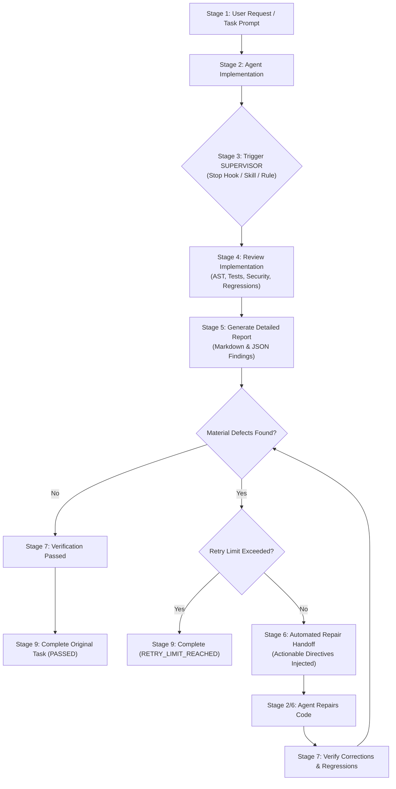

# SUPERVISOR: AI Coding Supervision & Automatic Repair System

**SUPERVISOR** is an autonomous supervision and automatic repair system built for AI coding agents.

> **Central Principle**: A coding task is not complete merely because the AI agent has finished writing code. It is complete only after SUPERVISOR has reviewed the implementation and verified the result, or has transparently reported why verification could not be completed.

---

## 1. Architecture Overview

SUPERVISOR works alongside AI coding agents rather than replacing them. It implements a rigorous 9-stage lifecycle:



---

## 2. Supported Platform Capabilities & Integration Strategy

### Google Antigravity Integration
1. **Lifecycle Hooks (`.agents/hooks.json`)**:
   - Utilizes the `Stop` event (`terminationReason: "model_stop"`).
   - Automatically intercepts the agent when it attempts to conclude its turn.
   - If material findings exist, the hook emits `{"decision": "continue", "reason": "<actionable repair prompt>"}`.
   - Resumes the coding agent immediately without requiring the user to prompt it.
2. **First-Class Skills & Slash Command (`.agents/skills/supervisor/SKILL.md`)**:
   - Discovered automatically by Antigravity.
   - Provides native `/supervisor` slash command in the chat canvas and CLI.
3. **Workspace Rules (`GEMINI.md`, `AGENTS.md`, `.agents/rules/AGENTS.md`)**:
   - Persistent hierarchical rules loaded into model context to enforce verification before completion.
4. **Subagents (`invoke_subagent`, `define_subagent`)**:
   - Can be used in multi-agent configurations where a dedicated auditor subagent runs the review.

### Cross-Platform Architecture
The core review and verification engine (`supervisor/`) is completely decoupled from platform-specific UI:
- **Claude Code**: Integrated via pre-commit or post-bash hooks.
- **OpenAI Codex / Custom Agents**: Executed via standard CLI (`python -m supervisor review`).
- **CI / Git Repositories**: Run as a quality gate or git hook.

---

## 3. Installation & Usage

### Setup in Workspace
```powershell
# Clone or enter workspace
cd C:\Users\DELL\Downloads\SUPERVISOR

# Install package locally (optional)
pip install -e .
```

### CLI Commands

#### Review Current Workspace (Default)
Inspects git diffs, file changes, runs syntax/security checks and tests, and generates reports:
```powershell
python -m supervisor review
```

#### Report-Only Mode
Evaluates the codebase and produces reports without triggering automated repair handoff:
```powershell
python -m supervisor review --report-only
```

#### Post-Repair Verification
Re-evaluates previous findings, checks for regressions, and reruns tests:
```powershell
python -m supervisor verify
```

#### Check Current Status
Displays the active lifecycle state, cycle count, and unresolved findings:
```powershell
python -m supervisor status
```

#### Reset Supervision Session
Clears session state and starts fresh:
```powershell
python -m supervisor reset
```

---

## 4. Lifecycle States

| State | Description |
| :--- | :--- |
| `IMPLEMENTING` | Coding agent is actively writing code for the user prompt. |
| `REVIEW_PENDING` | Agent finished coding; review trigger has fired. |
| `REVIEWING` | SUPERVISOR is parsing ASTs, checking security, running tests. |
| `FIXES_REQUIRED` | Material issues found; actionable directives generated. |
| `REPAIRING` | Agent is applying fixes without waiting for user intervention. |
| `VERIFYING` | SUPERVISOR is re-evaluating findings and checking for regressions. |
| `PASSED` | All verification checks have passed by concrete evidence. |
| `BLOCKED` | External factors prevent verification (missing permissions, etc.). |
| `RETRY_LIMIT_REACHED`| Configured max retries reached with unresolved defects. |

---

## 5. Report & Finding Schema (Stage 5)

Each finding contains:
- **Finding ID**: Unique identifier (e.g. `SEC-0042`, `SYNTAX-1029`, `TEST-FAIL-0012`).
- **Severity**: `CRITICAL`, `HIGH`, `MEDIUM`, `LOW`, `INFO`.
- **Category**: `BUG`, `MISSING_REQUIREMENT`, `REGRESSION`, `SECURITY`, `ERROR_HANDLING`, `DEPENDENCY_CONFIG`, `INTEGRATION`, `TESTING`, `PERFORMANCE`, `SPEC_MISMATCH`.
- **File & Location**: Relative path and 1-indexed line number.
- **Description**: Factual defect explanation.
- **Evidence**: Concrete code excerpt or error traceback.
- **Why It Matters**: Practical impact.
- **Recommended Correction**: Actionable fix.
- **Verification Method**: Test or check that proves resolution.
- **Status**: `CONFIRMED`, `SUSPECTED`, `RECOMMENDED`, `RESOLVED`, `UNRESOLVED`.

Generated reports are persisted in:
- Markdown: `.supervisor/latest_report.md` and `.supervisor/reports/report_cycle_<N>.md`
- JSON: `.supervisor/latest_report.json` and `.supervisor/reports/report_cycle_<N>.json`

---

## 6. Testing

The system includes a 28-test comprehensive suite covering models, state management, AST inspection, test runner, review engine, reporter, repair handoff, verification, and end-to-end lifecycle simulation:

```powershell
python -m unittest discover -s tests -v
```

---

## 7. Known Limitations & Honest Disclosure

- **Dynamic Test Execution**: If tests are not defined in the workspace or require external services (e.g. database, remote API), SUPERVISOR reports that dynamic tests were not executed rather than fabricating a passing test result.
- **Hook Availability in Headless / Minimal CLIs**: In environments where `.agents/hooks.json` is not evaluated by the host runtime, SUPERVISOR relies on persistent rules (`GEMINI.md` / `AGENTS.md`) and the manual `/supervisor` command to ensure the review cycle is performed.
