# Antigravity Agents, Subagents & Multi-Agent Collaboration Research

## 1. Executive Definition
Antigravity features a native, asynchronous multi-agent orchestration architecture. A parent agent session can dynamically spawn, coordinate, message, and terminate specialized background **Subagents** to perform isolated research, independent code reviews, or parallel implementation tasks.

- **Primary Documentation Sources**:
  - `https://antigravity.google/docs/agent`
  - `https://antigravity.google/docs/agent-settings`
- **Internal Reference**: SDK Reference (`builtin/skills/antigravity_guide/references/sdk.md`)

---

## 2. Core Subagent Primitives & Tool Contracts

The Antigravity agent runtime equips the primary agent with four first-class management tools:

### A. `define_subagent`
Dynamically registers a custom subagent type for the duration of the conversation:
* **`name`**: Unique identifier (e.g., `supervisor-auditor`).
* **`system_prompt`**: Specialized instructions defining the subagent's role, persona, and constraints.
* **`enable_write_tools`**: Boolean enabling or disabling filesystem write and command execution tools.
* **`enable_mcp_tools`**: Boolean granting access to configured MCP servers.

### B. `invoke_subagent`
Instantiates one or more concurrent subagents:
* **`TypeName`**: Name of built-in (`self`, `research`) or custom defined agent.
* **`Role`**: Human-readable job title (e.g., `Independent Security Auditor`).
* **`Prompt`**: Actionable task description.
* **`Model`**: Model selection (`inherit`, `flash_lite`, `flash`, `pro`).
* **`Workspace`**: Filesystem isolation mode:
  * `inherit`: Subagent operates directly in the parent's working directory.
  * `branch`: Creates a fresh, isolated workspace branched/cloned from parent (using Git worktrees).
  * `share`: Shares underlying repository storage while enabling isolated branching.

### C. `send_message`
Sends targeted, bidirectional messages to a running subagent or peer agent using its `conversationId`. Allows the orchestrator to pass findings, give new directions, or request status updates mid-flight.

### D. `manage_subagents`
Performs supervisory operations across all active subagents:
* `Action`: `list`, `kill`, `kill_all`.
* Observes live state: `running`, `idle`, `waiting_for_input`, `waiting_for_message`, `errored`.

---

## 3. Subagent Collaboration Capabilities for Supervision

| Capability | Supported? | Technical Implementation & Limitations |
| :--- | :--- | :--- |
| **Specialized Auditor Agent** | ✅ **YES** | Can define a read-only or diagnostic auditor subagent via `define_subagent` or Markdown config in `.agents/agents/`. |
| **Passing Tasks & Context** | ✅ **YES** | The initial prompt to `invoke_subagent` receives the task requirements and target file list. |
| **Receiving Structured Reports** | ✅ **YES** | Subagents output text and markdown reports, which are delivered back to the parent agent upon completion. |
| **Inspecting Work of Another** | ✅ **YES** | If configured with `Workspace: "inherit"`, the subagent directly reads files, diffs, and git status created by the coding agent. |
| **Coordinating Review & Repair** | ✅ **YES** | Parent agent can orchestrate turns: (1) Coding agent writes code, (2) Auditor subagent reviews code, (3) Parent passes findings back. |
| **Resuming Worker Agent** | ✅ **YES** | Using `send_message(worker_id, repair_directives)`, the worker agent is reactivated with actionable repair tasks. |
| **Iteration & Loop Control** | ✅ **YES** | Parent agent acts as the state machine controller, tracking retry counts and terminating via `manage_subagents(kill)` if limits are exceeded. |
| **Preventing Recursive Loops** | ✅ **YES** | Strict conversation IDs and explicit role separation prevent agents from unintentionally reviewing their own review calls. |

---

## 4. Evaluative Trade-off: Independent Subagent vs. Single Agent Self-Supervision

```mermaid
graph TD
    subgraph Single Agent Self-Supervision
        SA_Code[Coding Agent Implements] --> SA_Stop[Stop Hook Intercepts]
        SA_Stop --> SA_SelfRev[Same Model Reviews Own Code]
        SA_SelfRev --> SA_Repair[Same Model Repairs Code]
    end

    subgraph Two-Agent Dual Supervision
        TA_Parent[Orchestrator Agent] --> TA_Coder[Coding Subagent Implements]
        TA_Coder --> TA_Handoff[Handoff Code]
        TA_Handoff --> TA_Auditor[Independent Auditor Subagent Reviews]
        TA_Auditor --> TA_Findings[Structured Report]
        TA_Findings --> TA_CoderRepair[Coding Subagent Repairs]
    end
```

### Comparative Analysis:

| Dimension | Single-Agent with Hooks | Multi-Agent (Parent + Auditor Subagent) |
| :--- | :--- | :--- |
| **Cognitive Independence** | ⚠️ Moderate. The model may suffer from confirmation bias when grading its own code. | 🌟 High. Auditor starts with a clean context, evaluating code purely on evidence and AST checks. |
| **Token & Time Overhead** | ⚡ Minimal. Reuses existing context and fast external Python CLI. | 🐢 Higher. Requires spinning up a second agent context and message handoffs. |
| **Determinism** | 🌟 Highest. Review is executed by an objective deterministic Python engine (`ReviewEngine`), not purely by LLM opinion. | ⚠️ Variable. If the subagent relies solely on LLM judgment without scripts, findings may vary. |
| **Execution Reliability** | 🌟 High. Directly bound to the local workspace via `.agents/hooks.json`. | 🌟 High. Fully native Antigravity primitives. |

### Architectural Conclusion:
The most robust supervision architecture is a **Hybrid Engine**:
1. Use deterministic Python analysis (`CodeInspector`, AST parsing, test execution, security scanning) for the actual audit, avoiding subjective LLM hallucination.
2. For single-agent workflows (the default interactive coding experience), drive this engine via the `Stop` lifecycle hook.
3. For multi-agent workflows, wrap this exact same engine inside a specialized `supervisor-auditor` subagent.
4. **No external server or daemon is needed**: Native Antigravity tools (`invoke_subagent`, `send_message`, `hooks.json`) provide 100% of the necessary primitives.
