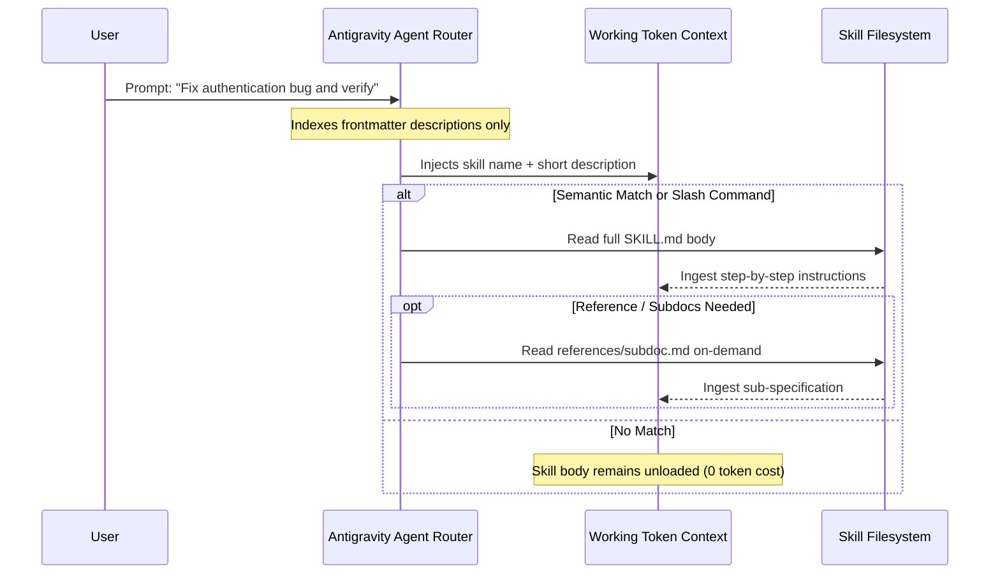

# Antigravity Skills Specification & Capability Research

## 1. Executive Definition
In Google Antigravity, an **Agent Skill** is a modular, folder-based package of knowledge, execution runbooks, and procedural instructions that extends the capabilities of an AI coding agent. Rather than treating prompts as monolithic context injections, Antigravity implements skills as an open standard (aligned with `agentskills.io`) enabling on-demand, progressive instruction disclosure and first-class tool/slash-command orchestration.

- **Primary Documentation Source**: `https://antigravity.google/docs/skills`
- **Internal Specification Reference**: Built-in skill `agy-customizations` (`builtin/skills/agy-customizations/docs/skills.md`)

---

## 2. Directory Layout & Structure

A skill must be encapsulated inside its own dedicated directory named after the skill identifier within a supported `skills/` directory:

```text
<skills_root>/<skill-name>/
├── SKILL.md          # MANDATORY: Metadata header & operational instructions
├── scripts/          # OPTIONAL: Executable helper scripts (Python, Bash, Node, PowerShell)
├── examples/         # OPTIONAL: Reference implementations & test fixtures
├── resources/        # OPTIONAL: Static assets, schemas, templates, checklists
└── references/       # OPTIONAL: In-depth technical documentation loaded on-demand
```

---

## 3. The `SKILL.md` File Specification

The `SKILL.md` file is the core contract between the skill author and the Antigravity agent router. It consists of two structural zones:

### A. YAML Frontmatter (Metadata Header)
The YAML frontmatter is delimited by triple dashes (`---`) at byte 0 of the file. It is the **only** portion of the skill ingested during the initial startup discovery index.

```yaml
---
name: supervisor
description: >-
  Reviews work produced by AI coding agents, identifies bugs, missing requirements, regressions,
  and security vulnerabilities, generates structured findings reports, and automatically initiates
  a repair cycle to fix identified defects before tasks are considered complete.
---
```

#### Frontmatter Field Constraints:
* **`name`** (string, required): A unique lowercase, hyphen-delimited string (e.g., `supervisor`, `python-lint`, `database-migrate`). This value defines the programmatic identifier and directly generates the slash command `/<name>`.
* **`description`** (string, required): The semantic trigger description. Written in third-person, imperative language describing *what* the skill does and *when/under what conditions* the agent should autonomously invoke it.

### B. Markdown Instruction Body
Contains the procedural instructions, command invocations, decision trees, and validation steps. This body is **never** loaded into the model's active working context during initial conversation boot. It is ingested strictly when the skill is selected or invoked.

---

## 4. Discovery Mechanisms & Loading Priority

Antigravity uses a deterministic filesystem hierarchy to discover skills across environments.

### Supported Discovery Locations:

1. **Workspace Project Root (Highest Precedence)**:
   - `<workspace_root>/.agents/skills/<skill-name>/SKILL.md`
   - Checked into version control to share team-wide practices.
2. **Global Configuration Root**:
   - `~/.gemini/config/skills/<skill-name>/SKILL.md`
   - Shared across all projects on the developer's workstation.
3. **Declared JSON Manifests**:
   - Explicitly declared in `<workspace_root>/skills.json` or `~/.gemini/config/skills.json`.
4. **Built-in / Bundled Skills**:
   - Mounted internally by the platform runtime (e.g., `builtin/skills/*`).

### Backward Compatibility / Legacy Aliases:
Antigravity maintains backward compatibility by searching alternative hidden folder prefixes in the workspace root in the following order:
- `.agents/`
- `_agents/`
- `.agent/`
- `_agent/`

---

## 5. Lifecycle Mechanics: Progressive Disclosure

To prevent context exhaustion and token waste, Antigravity enforces **Progressive Disclosure**:



### Tri-State Skill Lifecycle:
1. **Available**: The skill directory and valid `SKILL.md` exist in a discovered location. The agent router knows its `name` and `description`.
2. **Selected**: The user typed `/<name>` OR the model's semantic router determined that the incoming task prompt matches the `description` criteria. The markdown body of `SKILL.md` is ingested into working memory.
3. **Executing**: The agent reads the instructions and calls workspace tools (e.g., `run_command`, `replace_file_content`, `view_file`) or invokes scripts in `scripts/` to execute the described runbook.

---

## 6. Detailed Analysis of Specific Skill Questions

### Q1: Can a skill be invoked manually?
**CONFIRMED (Documented & Verified)**.
Typing `/<skill-name>` into the Antigravity chat input box or CLI prompt immediately selects and mounts the skill, bypassing semantic routing.

### Q2: Can a skill be invoked automatically?
**CONFIRMED (Documented & Verified)**.
The agent router compares the user prompt against all registered skill `description` fields. If high semantic relevance is found, the agent autonomously activates the skill.

### Q3: How are skill names converted into slash commands?
**CONFIRMED (Documented & Verified)**.
The slash command name is an exact 1:1 match with the `name` field in the YAML frontmatter. If `name: supervisor`, typing `/supervisor` triggers the skill.

### Q4: Can one skill invoke another skill?
**PLAUSIBLE (Requires Tool Indirection)**.
A skill cannot directly "call" another skill via a native programmatic API in `SKILL.md`. However, a skill's instructions can direct the agent to activate another skill by name (e.g., "Now read and follow instructions in skill `security-scan`") or invoke a subagent with that skill enabled.

### Q5: Can skills use scripts, resources, and reference files?
**CONFIRMED (Documented & Verified)**.
Skills can bundle helper code inside `scripts/`, templates in `resources/`, and extended documentation in `references/`. The agent accesses these using relative markdown links (e.g., `[helper](scripts/check.py)`), which the agent resolves relative to the skill's root directory.

### Q6: Can a skill execute code directly, or does execution depend on agent tools?
**CONFIRMED (Documented & Verified)**.
A skill has **no autonomous execution engine**. It is pure Markdown instruction. Execution strictly depends on the agent possessing write and terminal execution tools (e.g., `run_command`, `write_to_file`). If the host environment runs with restricted tool permissions or sandboxing, skill script execution is bounded by those same permissions.

### Q7: What happens if a skill is discovered but never selected?
**CONFIRMED (Documented & Verified)**.
It consumes only a minimal token footprint corresponding to its `name` and one-sentence `description` in the router index. Its instruction body, scripts, and references are never read.

### Q8: Can a skill guarantee that it runs at the end of every coding task?
**UNSUPPORTED / NOT GUARANTEED by Skills Alone**.
A skill cannot self-schedule or force itself to execute. If an agent implements a coding task, the model may conclude its turn (`model_stop`) without ever deciding to invoke the supervision skill. To achieve guaranteed execution at task completion, a skill must be coupled with an authoritative lifecycle mechanism (such as the `Stop` lifecycle hook) or an enforced workspace rule.

### Q9: Can a skill prevent the original agent task from being marked complete?
**UNSUPPORTED by Skills Alone**.
Skills lack lifecycle interception primitives. Once the agent emits its final response text without calling tools, the turn completes. A skill cannot physically intercept the engine termination signal unless backed by a lifecycle hook (`Stop`).

---

## 7. Implications for SUPERVISOR
1. **Role of the Skill**: The `supervisor` skill is the primary interface for manual invocation (`/supervisor`) and provides the formal step-by-step review and repair instructions for the agent.
2. **Enforcement Limitation**: The existence of `.agents/skills/supervisor/SKILL.md` does *not* guarantee automatic supervision. SUPERVISOR must utilize a combination of lifecycle hooks (`hooks.json`) and workspace rules (`AGENTS.md` / `GEMINI.md`) to guarantee execution.

