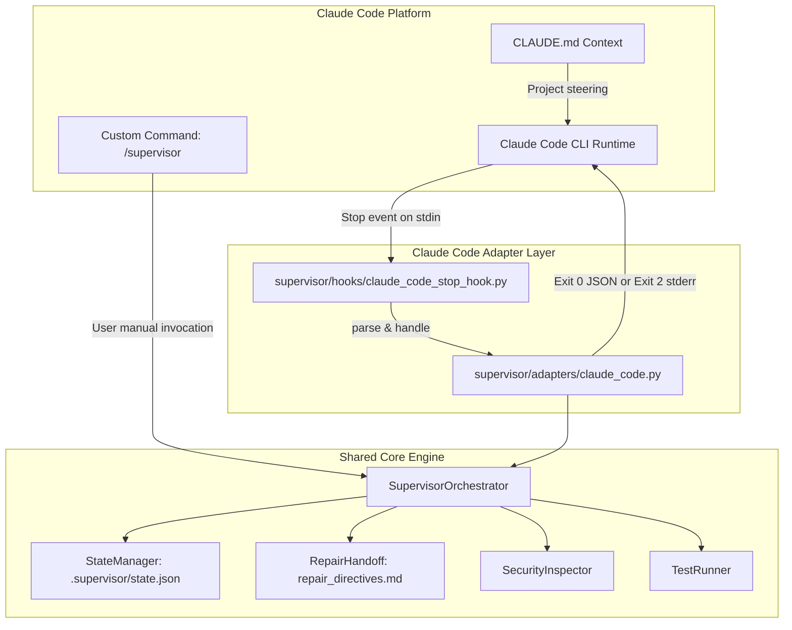

# Claude Code Integration Specification

## 1. Overview and Architecture

SUPERVISOR integrates with **Claude Code** through two primary mechanisms:
1. **Claude Code CLI Lifecycle Hooks**: Deterministic completion gating via the native `Stop` lifecycle hook configured in `.claude/settings.json`.
2. **Claude Code Custom Commands**: Reusable manual slash command `/supervisor` configured via `.claude/commands/supervisor.md`.

Both mechanisms connect directly to the shared, platform-independent SUPERVISOR core (`supervisor/`) without altering review logic, test runners, AST parsers, or findings schemas.



---

## 2. Supported Claude Code Integration Mechanisms

### A. Claude Code CLI Native Hook (`Stop`)
* **Discovery Location**: `.claude/settings.json` in repository root or `~/.claude/settings.json` globally.
* **Trigger Event**: `Stop` event triggers automatically when the assistant finishes responding at the end of an implementation turn.
* **Input Channel**: Claude Code writes a JSON payload to `stdin` containing session and workspace context (`session_id`, `cwd`, `hook_event_name: "Stop"`, `transcript_path`, `stop_hook_active`, `last_assistant_message`).
* **Completion Gate Contract**:
  - **Clean / Passing Review**: The hook outputs `{}` or `{"decision": "allow", "reason": "SUPERVISOR verification PASSED..."}` on `stdout` with exit code `0`. Claude Code concludes the turn.
  - **Defects Detected (Continuation Required)**: The hook can block completion using either of two official Claude Code modalities:
    1. *Structured JSON mode (default)*: Exits `0` and outputs `{"decision": "block", "reason": "<directives>"}` on `stdout`. Claude Code intercepts the block and injects the `reason` back into the assistant context for the next turn.
    2. *Imperative mode*: Exits `2` and outputs the repair directives on `stderr`. Claude Code captures `stderr` as feedback to resume the agent.

### B. Project Instructions (`CLAUDE.md`)
* Claude Code automatically loads `CLAUDE.md` from the repository root into memory.
* `CLAUDE.md` defines the mandatory behavioral contract:
  - Coding tasks are not complete until verified by SUPERVISOR.
  - Repairs must be applied immediately without asking for user permission.
  - Unrelated files and existing conventions must be preserved.

### C. Manual Slash Command (`/supervisor`)
* Configured via `.claude/commands/supervisor.md`.
* Accessible directly in the Claude Code terminal prompt by typing `/supervisor`.
* Defaults to full review, autonomous repair, re-review, and verification (`python -m supervisor review`).
* Supports explicit report-only mode: `python -m supervisor review --report-only`.

---

## 3. Installation and Configuration

### A. Configuration File: `.claude/settings.json`
```json
{
  "hooks": {
    "Stop": [
      {
        "matcher": "",
        "hooks": [
          {
            "type": "command",
            "command": "python -m supervisor.hooks.claude_code_stop_hook",
            "timeout": 60
          }
        ]
      }
    ]
  }
}
```

### B. Custom Slash Command: `.claude/commands/supervisor.md`
```markdown
---
description: Run SUPERVISOR review and autonomous repair cycle on current workspace
---

# SUPERVISOR Review & Repair

Run the SUPERVISOR quality review and autonomous repair workflow:
1. Execute `python -m supervisor review`
2. If material defects are identified, immediately apply recommended corrections without waiting for confirmation.
3. Run `python -m supervisor verify`.
```

### C. Permissions and Trust
- Claude Code executes command hooks locally. In accordance with Claude Code's security model, hooks configured in project settings execute using the user's terminal privileges.
- You can inspect active hooks in the CLI via the interactive `/hooks` command or reload configurations with `claude hooks reload`.

### D. Safe Disabling
To temporarily disable SUPERVISOR in Claude Code:
1. Remove or comment out the `"Stop"` entry in `.claude/settings.json`.
2. Run `claude hooks reload` in the active session.

---

## 4. Execution Lifecycle & Repair Handoff

| Stage | Action in Claude Code |
| :--- | :--- |
| **1. Agent Implements** | Claude Code writes code in workspace according to task prompt. |
| **2. Turn Finish** | Claude Code triggers the `Stop` hook, passing context JSON on `stdin`. |
| **3. Hook Review** | `ClaudeCodeAdapter` loads state, runs AST inspection, secret scanning, and tests. |
| **4. Defect Detected** | Hook writes `.supervisor/repair_directives.md`, sets state to `REPAIRING`. |
| **5. Autonomous Handoff** | Hook outputs `{"decision": "block", "reason": safe_directives}` (or exit `2` with `stderr`). |
| **6. Agent Resumes** | Claude Code receives the feedback prompt and immediately repairs defects without user prompt. |
| **7. Re-verification** | Agent finishes repairs, triggering the `Stop` hook again. |
| **8. Completion Gate** | Review engine confirms 0 material defects, outputs `{"decision": "allow"}`, exiting with `0`. |

---

## 5. What Is Automatic vs. What Requires User Action

| Behavior | Automation Level | Notes |
| :--- | :--- | :--- |
| Initial review trigger | **Automatic** | Fired on `Stop` event by Claude Code CLI. |
| Defect detection & reporting | **Automatic** | Shared review engine evaluates code deterministically. |
| Directive formulation | **Automatic** | `RepairHandoff` crafts concise, actionable instructions. |
| Agent resumption | **Automatic (CLI Hook)** | Claude Code re-prompts the model using hook feedback. |
| Secret redaction | **Automatic** | Secrets (API keys, private keys) are masked before output. |
| Re-review & verification | **Automatic** | Fired on subsequent `Stop` events until `PASSED` or retry limit. |
| Manual review request | **Manual** | User can explicitly run `/supervisor` or `python -m supervisor review`. |
| External environment blockers | **Manual** | If dependencies or networks are broken, state becomes `BLOCKED`. |

---

## 6. Coexistence with Antigravity and Codex

Claude Code, OpenAI Codex, and Google Antigravity coexist in the same repository with zero conflict:
- **Google Antigravity**: `.agents/hooks.json` (targets `supervisor.hooks.stop_hook`), `.agents/skills/supervisor/SKILL.md`, `GEMINI.md`.
- **OpenAI Codex**: `.codex/hooks.json` (targets `supervisor.hooks.codex_stop_hook`), `AGENTS.md`.
- **Claude Code**: `.claude/settings.json` (targets `supervisor.hooks.claude_code_stop_hook`), `.claude/commands/supervisor.md`, `CLAUDE.md`.
- All three platforms share `.supervisor/state.json` and `.supervisor/repair_directives.md`. Advisory file locking prevents race conditions.

---

## 7. Verification Status & Evidence Categorization

In accordance with strict project reporting rules:

| Category | Status | Notes |
| :--- | :--- | :--- |
| **Code Implementation** | **Implemented** | `ClaudeCodeAdapter`, `claude_code_stop_hook.py`, settings, commands. |
| **Unit Testing** | **Tested (16 tests)** | 16 dedicated category tests in `tests/test_claude_code_integration.py`. |
| **Subprocess Testing** | **Tested** | Unmocked subprocess fixture in `tests/test_claude_code_real_lifecycle_fixture.py`. |
| **Official Documentation** | **Verified** | Verified against official Claude Code CLI hooks and slash command specifications. |
| **Actual Host Validation** | **Not Directly Exercised** | An external Claude Code interactive CLI window was not launched inside this Antigravity session. Subprocess stdin/stdout/stderr protocol execution was verified locally. |

---

## 8. Reproducible End-to-End Validation Procedure

To validate the Claude Code integration locally:

```bash
# 1. Run all unit and integration tests (including 16 Claude Code tests)
python -m unittest discover -s tests -v

# 2. Run unmocked subprocess lifecycle tests for Claude Code
python -m unittest tests/test_claude_code_real_lifecycle_fixture.py -v

# 3. Verify repository integrity with supervisor verify
python -m supervisor verify
```

