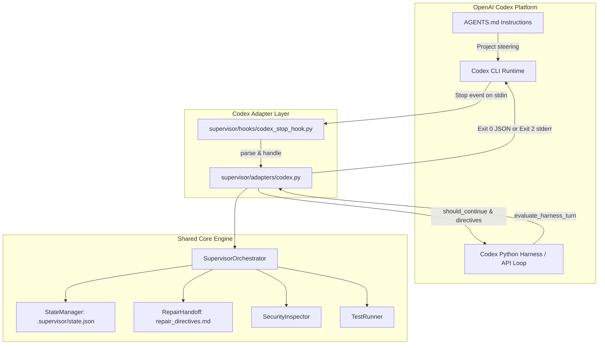

# OpenAI Codex Integration Specification

## 1. Overview and Architecture

SUPERVISOR integrates with **OpenAI Codex** through two supported mechanisms:
1. **OpenAI Codex CLI**: Deterministic completion gating via the native `Stop` lifecycle hook (`.codex/hooks.json`).
2. **Codex Programmatic Harness**: Decorator/wrapper loop for OpenAI Assistants API or custom Chat Completions agent loops.

Both mechanisms connect directly to the shared, platform-independent SUPERVISOR core (`supervisor/`) without altering review logic, test runners, AST parsers, or findings schemas.



---

## 2. Supported Codex Integration Mechanisms

### A. Codex CLI Native Hook (`Stop`)
* **Discovery Location**: `.codex/hooks.json` in repository root or `~/.codex/hooks.json` globally.
* **Trigger Event**: `Stop` event fires automatically when the agent completes a turn or session.
* **Input Channel**: Codex writes a JSON payload to `stdin` containing session and workspace context.
* **Completion Gate Contract**:
  - **Clean / Passing Review**: The hook outputs `{}` or `{"decision": "allow", "reason": "SUPERVISOR verification PASSED..."}` on `stdout` with exit code `0`. Codex permits completion.
  - **Defects Detected (Continuation Required)**: The hook can block completion using either of two official Codex modalities:
    1. *Structured JSON mode (default)*: Exits `0` and outputs `{"decision": "block", "reason": "<directives>"}` on `stdout`. Codex intercepts the block and injects the `reason` back into the agent context for the next turn.
    2. *Imperative mode*: Exits `2` and outputs the repair directives on `stderr`. Codex reads `stderr` as feedback and forces another model turn.

### B. Project Instructions (`AGENTS.md`)
* Codex CLI automatically loads `AGENTS.md` from the repository root up to the working directory.
* `AGENTS.md` defines the behavioral contract:
  - Coding tasks are not complete until verified by SUPERVISOR.
  - Repairs must be applied immediately without asking for user permission.
  - Unrelated files and existing conventions must be preserved.

### C. Programmatic Harness Loop (`evaluate_harness_turn`)
* For applications using the OpenAI Assistants API or tool-calling loops:
  ```python
  from supervisor.adapters.codex import CodexAdapter

  adapter = CodexAdapter(workspace_root)
  result = adapter.evaluate_harness_turn(
      agent_message=assistant_reply,
      original_prompt=user_prompt
  )

  if result["should_continue"]:
      # Append directives to thread and re-run model
      thread.add_message(role="user", content=result["directives"])
      run = client.beta.threads.runs.create_and_poll(...)
  ```

---

## 3. Installation and Configuration

### Configuration File: `.codex/hooks.json`
```json
{
  "hooks": {
    "Stop": [
      {
        "type": "command",
        "command": "python -m supervisor.hooks.codex_stop_hook",
        "timeout": 60
      }
    ]
  }
}
```

### Trust Boundary
Codex CLI requires non-managed command hooks to be trusted. Run:
```bash
codex hooks trust
```
or approve the hook when prompted by Codex CLI.

---

## 4. Execution Lifecycle & Repair Handoff

| Stage | Action in Codex |
| :--- | :--- |
| **1. Agent Implements** | Codex writes code in workspace according to task prompt. |
| **2. Turn Finish** | Codex triggers the `Stop` hook, passing context JSON on `stdin`. |
| **3. Hook Review** | `CodexAdapter` loads state, runs AST inspection, secret scanning, and tests. |
| **4. Defect Detected** | Hook writes `.supervisor/repair_directives.md`, sets state to `REPAIRING`. |
| **5. Autonomous Handoff** | Hook outputs `{"decision": "block", "reason": safe_directives}` (or exit `2` with `stderr`). |
| **6. Agent Resumes** | Codex receives the feedback prompt and immediately repairs defects without user prompt. |
| **7. Re-verification** | Agent finishes repairs, triggering the `Stop` hook again. |
| **8. Completion Gate** | Review engine confirms 0 material defects, outputs `{"decision": "allow"}`, exiting with `0`. |

---

## 5. What Is Automatic vs. What Requires User Action

| Behavior | Automation Level | Notes |
| :--- | :--- | :--- |
| Initial review trigger | **Automatic** | Fired on `Stop` event by Codex CLI. |
| Defect detection & reporting | **Automatic** | Shared review engine evaluates code deterministically. |
| Directive generation | **Automatic** | `RepairHandoff` crafts concise, actionable instructions. |
| Agent resumption | **Automatic (CLI Hook / API)** | Codex re-prompts the model using hook feedback. |
| Secret redaction | **Automatic** | Secrets (API keys, private keys) are masked before output. |
| Re-review & verification | **Automatic** | Fired on subsequent `Stop` events until `PASSED` or retry limit. |
| Hook trust approval | **One-time Manual** | User must trust the hook in Codex CLI once (`codex hooks trust`). |
| External environment blockers | **Manual** | If dependencies or networks are broken, state becomes `BLOCKED`. |

---

## 6. Coexistence with Antigravity

Codex and Antigravity coexist in the same repository with zero conflict:
- **Antigravity** uses `.agents/hooks.json` targeting `supervisor.hooks.stop_hook` and camelCase payloads.
- **Codex** uses `.codex/hooks.json` targeting `supervisor.hooks.codex_stop_hook` and snake_case payloads.
- Both share the identical `.supervisor/state.json` and `.supervisor/repair_directives.md`.
- Shared lock handling prevents racing or duplicate execution.

---

## 7. Platform Nuances and Limitations

1. **Strict Output Schema**: Unlike `UserPromptSubmit`, the Codex `Stop` hook validates output strictly against `deny_unknown_fields`. Arbitrary metadata fields cause schema errors. The adapter outputs only valid keys (`decision`, `reason`).
2. **Exit Code 2 vs 0**: Exit code 2 is supported for imperative blocking in environments that prefer stderr streams over structured JSON stdout.
3. **Stale Lock Recovery**: If an agent process crashes while in `REVIEWING` state, the adapter detects locks older than 30 seconds and safely resets to `IMPLEMENTING`.
4. **Offline Operation**: The core requires no internet access or API keys to perform static analysis and local test execution.

---

## 8. Reproducible End-to-End Validation Procedure

To validate the Codex integration locally:

```bash
# 1. Run all unit and integration tests (including 13 Codex integration tests)
python -m unittest discover -s tests -v

# 2. Run unmocked subprocess lifecycle tests for Codex
python -m unittest tests/test_codex_real_lifecycle_fixture.py -v

# 3. Verify repository integrity with supervisor verify
python -m supervisor verify
```
