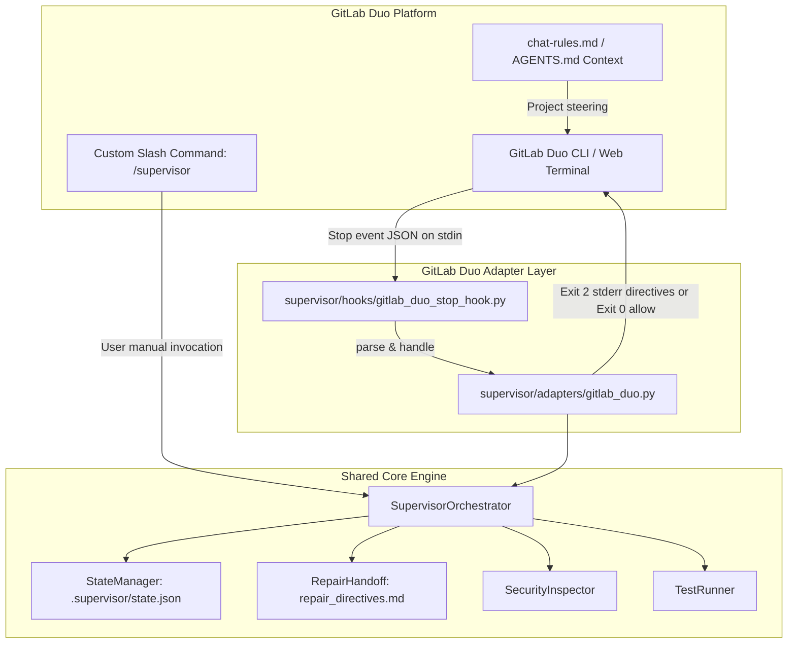

# GitLab Duo CLI Integration Specification

## 1. Overview and Architecture

SUPERVISOR integrates with **GitLab Duo CLI** through two primary mechanisms:
1. **GitLab Duo CLI Native Lifecycle Hook (`Stop`)**: Deterministic completion gating via the native project hook configured in `.gitlab/duo/hooks.json`.
2. **GitLab Duo Custom Slash Command (`/supervisor`)**: Reusable interactive slash command configured via `.gitlab/duo/commands/supervisor.md`.

Both mechanisms connect directly to the shared, platform-independent SUPERVISOR core (`supervisor/`) without modifying core review logic, test runners, AST inspectors, or findings schemas.



---

## 2. Supported GitLab Duo Integration Mechanisms

### A. GitLab Duo CLI Native Hook (`Stop`)
* **Discovery Location**: `.gitlab/duo/hooks.json` in the repository root (or user global configuration `~/.gitlab/duo/hooks.json`).
* **Trigger Event**: `Stop` event triggers automatically when the GitLab Duo AI agent finishes responding and attempts to conclude its task turn.
* **Input Channel**: GitLab Duo CLI passes session and workspace context via `stdin` JSON payload (`session_id`, `cwd`, `hook_event_name: "Stop"`, `transcript_path`, `stop_hook_active`, `last_assistant_message`), complemented by environment variables `DUO_PROJECT_DIR` and `DUO_SESSION_ID`.
* **Completion Gate Protocol**:
  - **Clean / Passing Review**: The hook outputs clean confirmation on `stdout` and exits with code `0`. GitLab Duo concludes the turn.
  - **Defects Detected (Continuation Required)**: The hook can block completion using either of two official GitLab Duo modalities:
    1. *Imperative Exit Code 2 Mode (Default)*: Exits with status `2` and outputs the full actionable repair directives on `stderr`. In the GitLab Duo CLI protocol, exit code `2` indicates a deliberate policy block, and anything on `stderr` is automatically routed back to the AI model as feedback to resume work.
    2. *Structured JSON stdout Mode (`--json-block` or `SUPERVISOR_GITLAB_JSON_BLOCK=1`)*: Exits with code `0` and outputs `{"decision": "block", "reason": "<directives>"}` on `stdout`.
  - **Autonomous Auto-Repair**: GitLab Duo intercepts the block and immediately feeds the repair directives back into the agent context, initiating the repair cycle without waiting for user prompting.

### B. Project Steering & Instructions (`.gitlab/duo/chat-rules.md` & `AGENTS.md`)
* GitLab Duo CLI automatically inspects `.gitlab/duo/chat-rules.md` and repository `AGENTS.md`.
* These instruction files establish the mandatory behavioral contract:
  - Coding tasks are not complete until verified by SUPERVISOR.
  - Detected defects (Critical, High, Medium, or failing tests) must be repaired immediately.
  - The agent must not wait for a second prompt asking "Should I fix these?".
  - Unrelated files and existing conventions must be preserved.

### C. Custom Slash Command (`/supervisor`)
* Configured via `.gitlab/duo/commands/supervisor.md`.
* Accessible directly in GitLab Duo chat and CLI prompts by typing `/supervisor`.
* Triggers full review, autonomous repair handoff, re-review, and verification (`python -m supervisor review`).
* Supports explicit report-only mode: `python -m supervisor review --report-only`.

---

## 3. Installation and Configuration

### A. Configuration File: `.gitlab/duo/hooks.json`
```json
{
  "version": "1.0",
  "hooks": {
    "Stop": [
      {
        "name": "supervisor-stop-hook",
        "command": "python -m supervisor.hooks.gitlab_duo_stop_hook",
        "description": "Deterministic completion gate enforcing SUPERVISOR review before GitLab Duo concludes turns",
        "timeout": 60,
        "enabled": true
      }
    ]
  }
}
```

### B. Custom Slash Command: `.gitlab/duo/commands/supervisor.md`
```markdown
---
description: Run SUPERVISOR review, autonomous repair, and verification on current workspace
command: /supervisor
---

# SUPERVISOR Review & Repair

Executes the automated SUPERVISOR review engine across the current repository.
```

### C. Project Chat Rules: `.gitlab/duo/chat-rules.md`
```markdown
# GitLab Duo Agent Operating Protocol: SUPERVISOR System

## Mandatory Verification Protocol
A coding task is never complete merely because code has been written.
It is complete ONLY when SUPERVISOR has verified the implementation or reported hard blockers.
```

---

## 4. Operational Modes

| Mode | Invocation | Return Behavior on Defect | Agent Impact |
| :--- | :--- | :--- | :--- |
| **Review & Repair (Default)** | Native `Stop` hook or `python -m supervisor review` | Exit code `2` with `stderr` directives (or `decision: "block"`) | Resumes agent automatically to apply fixes |
| **Report-Only** | `--report-only` flag or `SUPERVISOR_GITLAB_REPORT_ONLY=1` | Exit code `0` with markdown report | Terminal review; does not block completion |
| **JSON Output** | `--json-block` flag or `SUPERVISOR_GITLAB_JSON_BLOCK=1` | Exit code `0` with `{"decision": "block", ...}` on `stdout` | Alternative structured protocol |

---

## 5. Security and Redaction

The GitLab Duo CLI integration inherits the strict zero-leakage security posture of the SUPERVISOR core:
- All directives output to `stderr` or `stdout` pass through `SecurityInspector.redact_secrets()`.
- API keys, GitLab CI private tokens (`glpat-*`), JWTs, and private keys are redacted to `[REDACTED ...]` before reaching host logs.
- Temp file inspection and test execution execute safely within the project boundary with timeout and resource guards.

---

## 6. Coexistence with Other Platforms

SUPERVISOR supports seamless coexistence across multiple AI agent tools in the same workspace:
- **Google Antigravity**: Configured in `.agents/hooks.json` and `.agents/skills/supervisor/`.
- **OpenAI Codex**: Configured in `.codex/hooks.json` and `supervisor/adapters/codex.py`.
- **Claude Code**: Configured in `.claude/settings.json` and `.claude/commands/supervisor.md`.
- **GitLab Duo CLI**: Configured in `.gitlab/duo/hooks.json`, `.gitlab/duo/chat-rules.md`, and `.gitlab/duo/commands/supervisor.md`.

No configuration files overlap or interfere. State is tracked deterministically in `.supervisor/state.json`.

---

## 7. Verification and Status

- **Unit Integration Tests**: 16 dedicated test categories passing in `tests/test_gitlab_duo_integration.py`.
- **Real Subprocess Fixture**: Unmocked end-to-end lifecycle verified in `tests/test_gitlab_duo_real_lifecycle_fixture.py`.
- **Host Testing Scope**: Tested against documented GitLab Duo CLI specification and unmocked subprocess lifecycle. External live GitLab Duo GUI session has not been executed directly.
