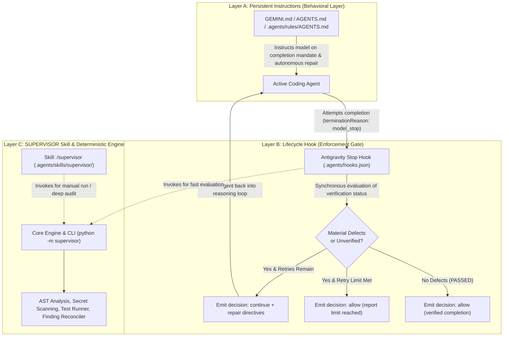
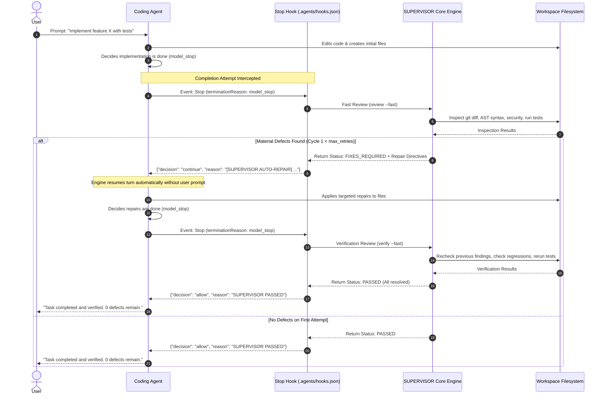

# SUPERVISOR System Architecture Specification

## 1. System Overview

**SUPERVISOR** is an autonomous AI coding supervision and automatic repair system designed to operate alongside AI coding agents.

### Central Operating Principle
> **A coding task is not complete merely because the AI agent has finished writing code. It is complete only after SUPERVISOR has reviewed the implementation and verified the result, or has transparently reported why verification could not be completed.**

SUPERVISOR transforms conventional AI pair programming—which is currently prone to premature completion, hallucinated verification, and unhandled regressions—into a closed-loop, verifiable engineering process.

---

## 2. The Tri-Layer Hybrid Architecture

Based on verified platform capabilities (documented in `docs/supervisor/platform-capabilities.md`), SUPERVISOR employs a **Tri-Layer Hybrid Architecture**. This design separates behavioral guidance, physical execution gating, and deterministic analysis into distinct, cooperating tiers.



---

## 3. Layer Responsibilities & Interactions

### Layer A: Persistent Instructions (Behavioral Guidance)
* **Configuration Target**: `GEMINI.md`, `AGENTS.md`, and `.agents/rules/AGENTS.md`.
* **Nature**: Unconditional, progressive context injection loaded on every agent invocation.
* **Responsibilities**:
  1. Communicates the mandate that no task is complete without SUPERVISOR verification.
  2. Tells the agent to preserve original task requirements throughout implementation and repairs.
  3. Prepares the model to immediately accept and execute incoming auto-repair directives without asking the user for confirmation.
  4. Forbids the model from claiming tests passed unless actual commands were executed.
* **Boundary**: Layer A is purely behavioral. It shapes the agent's intent, but cannot physically stop the engine runtime from terminating.

### Layer B: Lifecycle Hook (Deterministic Enforcement Gate)
* **Configuration Target**: `.agents/hooks.json` mapping event `Stop` to `python -m supervisor.hooks.stop_hook`.
* **Nature**: Synchronous runtime hook executed by the host environment whenever the model execution loop concludes.
* **Responsibilities**:
  1. Inspects the event payload (`terminationReason`). Skips user cancellations or system errors.
  2. Queries the state manager to inspect the latest verification status and cycle count.
  3. If material defects remain and `cycle < max_retries`:
     - Emits `{"decision": "continue", "reason": "<actionable repair prompt>"}`.
     - Physically blocks the engine from ending the task and forces the coding agent to repair the issues.
  4. If `cycle >= max_retries`:
     - Emits `{"decision": "allow", "reason": "Retry limit reached. Unresolved findings documented."}`.
  5. If no material defects remain:
     - Emits `{"decision": "allow", "reason": "SUPERVISOR verification PASSED."}`.
* **Boundary**: Layer B runs under a strict execution timeout (30s default). It must perform fast, lightweight checks or coordinate execution, never running unbounded external processes directly inside the hook.

### Layer C: SUPERVISOR Skill & Deterministic Engine (Analysis & Interface)
* **Configuration Target**: `.agents/skills/supervisor/SKILL.md` and the decoupled `supervisor/` Python package.
* **Nature**: Portable CLI tool and on-demand skill providing interactive slash command access (`/supervisor`) and deterministic code inspection.
* **Responsibilities**:
  1. Gathers context: git diffs, modified files, acceptance requirements from the prompt.
  2. Executes multi-language static analysis: AST parsing, dangerous call detection (`eval`, `exec`), bare/silent exception detection, secret detection.
  3. Discovers and safely executes workspace tests with configurable timeouts.
  4. Formats structured reports (Markdown & JSON) conforming to Stage 5 schema.
  5. Generates targeted, actionable repair directives for the coding agent.
  6. Reconciles previous findings across cycles to prevent duplicate reporting and detect regressions.
* **Boundary**: Layer C is 100% platform-independent and can be executed via terminal, CI pipelines, or alternative agent harnesses.

---

## 4. End-to-End Execution Data Flow



---

## 5. Architectural Boundaries: Core vs. Platform Adapters

To guarantee cross-platform reusability (supporting Antigravity, Claude Code, OpenAI Codex, GitLab Duo, and standalone CI), SUPERVISOR enforces a strict decoupling between the **Shared Core** and **Platform Adapters**:

```text
┌─────────────────────────────────────────────────────────────┐
│                       PLATFORM ADAPTERS                     │
│  ┌───────────────┐ ┌───────────────┐ ┌───────────────────┐  │
│  │  Antigravity  │ │  Claude Code  │ │   Standalone CI   │  │
│  │ (hooks.json,  │ │  (Bash hooks, │ │ (GitHub Actions,  │  │
│  │  SKILL.md,    │ │   .clauderc)  │ │  GitLab CI yaml)  │  │
│  │  AGENTS.md)   │ │               │ │                   │  │
│  └───────┬───────┘ └───────┬───────┘ └─────────┬─────────┘  │
└──────────┼─────────────────┼───────────────────┼────────────┘
           ▼                 ▼                   ▼
┌─────────────────────────────────────────────────────────────┐
│                    STABLE ADAPTER CONTRACT                  │
│   • ContextExtractionContract      • RepairDirectiveContract│
│   • ExecutionGatingContract        • NotificationContract   │
└──────────────────────────┬──────────────────────────────────┘
                           ▼
┌─────────────────────────────────────────────────────────────┐
│                     SUPERVISOR SHARED CORE                  │
│  ┌────────────────────┐ ┌────────────────────────────────┐  │
│  │ Context Collector  │ │ Static & AST Inspection Engine │  │
│  └────────────────────┘ └────────────────────────────────┘  │
│  ┌────────────────────┐ ┌────────────────────────────────┐  │
│  │ Test Runner Engine │ │ Findings Reconciler & Verifier │  │
│  └────────────────────┘ └────────────────────────────────┘  │
│  ┌────────────────────┐ ┌────────────────────────────────┐  │
│  │ State Machine FSM  │ │ Report Generator (MD & JSON)   │  │
│  └────────────────────┘ └────────────────────────────────┘  │
└─────────────────────────────────────────────────────────────┘
```

### Invariants:
1. **Core Zero-External-Dependency Rule**: The shared core relies exclusively on the Python standard library. It does not require cloud APIs, proprietary SDKs, or database engines.
2. **Adapter Isolation**: No Antigravity-specific concepts (such as `conversationId`, `injectSteps`, or protojson encoding) may exist inside the shared core modules. Adapters translate platform payloads into standard Core data models.
3. **Deterministic First**: AI-assisted evaluation is an optional extension (Layer C deep mode), never a hard requirement for standard code inspection.
