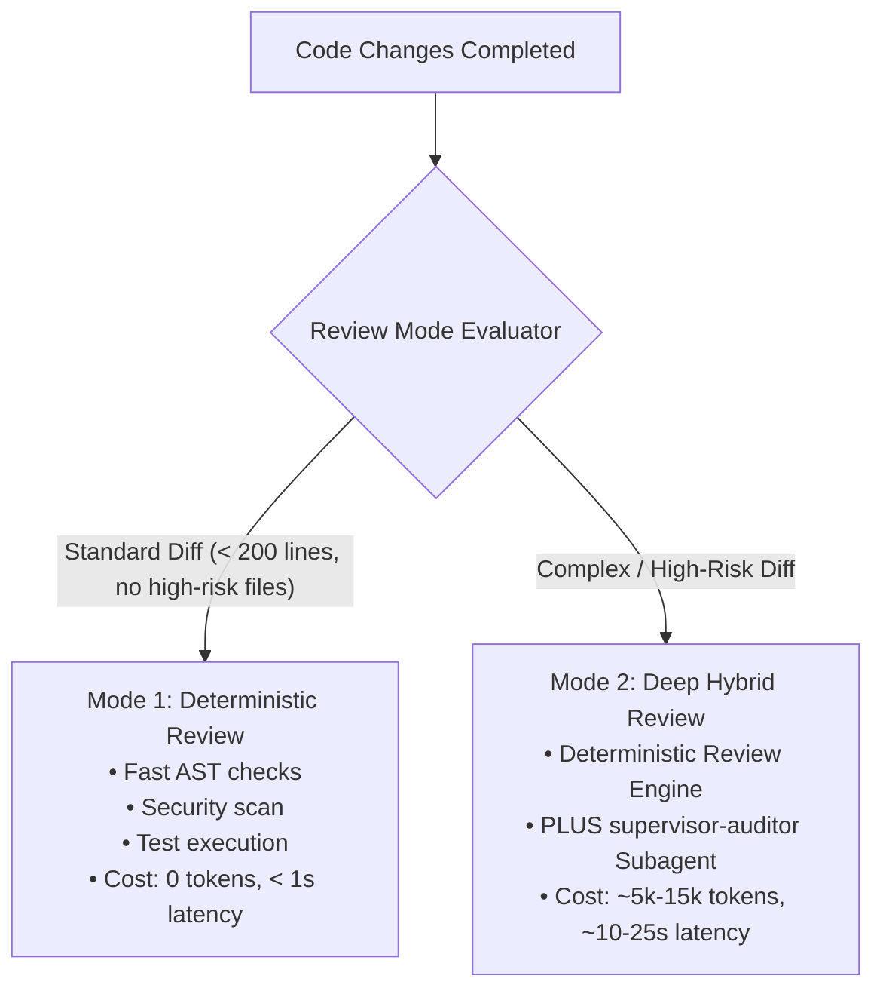
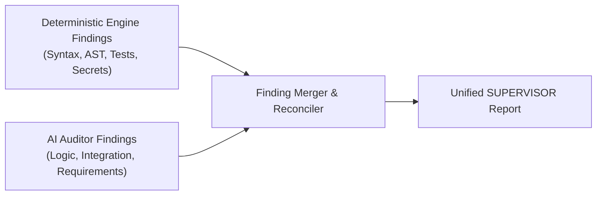

# SUPERVISOR Independent AI Auditor Specification (`supervisor-auditor`)

## 1. Role & Purpose

The **AI Auditor** (`supervisor-auditor`) is a specialized subagent profile designed to provide deep semantic, architectural, and requirement-fidelity review when deterministic static checks alone are insufficient.

### Non-Negotiable Operational Rules:
1. **Read-Only Posture**: The auditor is strictly an inspection agent. It possesses **zero file-write or modification tools**. It observes, inspects, and reports, but never edits code directly.
2. **Evidence-Based Citation**: Every finding reported by the auditor must cite concrete file paths, line ranges, and exact code excerpts. Speculative or aesthetic opinions without tangible failure modes are prohibited.
3. **Requirement Fidelity**: The auditor grades the implementation directly against the original user prompt and explicit criteria. It does not invent scope or penalize code for omitting unrequested features.

---

## 2. Review Modes & Selection Criteria

SUPERVISOR supports two operational review tiers:



### Mode 1: Deterministic Review (Default)
* **Trigger**: Ordinary modifications, single-file bugfixes, small features (< 200 lines changed), standard refactoring.
* **Execution**: Local Python CLI runs AST validation, credential checks, and test runner.
* **Cost & Latency**: 0 LLM tokens, executes in < 1 second.

### Mode 2: Deep Hybrid Review
* **Trigger**: Activated automatically when any of the following heuristic criteria are met:
  1. **High-Risk File Paths**: Changes touch security boundaries (e.g., `auth/`, `crypto/`, `permissions/`, `session/`), database migrations (`migrations/`, `schema.sql`), or payment gateways.
  2. **Architectural Complexity**: Changes span more than 5 distinct files or exceed 300 modified lines of code.
  3. **Explicit User Request**: Invoked with `/supervisor --deep` or requested in user prompt.
  4. **Unresolved Regressions**: When Cycle 2 verification fails, an auditor is invoked to diagnose persistent failures.
* **Execution**: Runs the deterministic engine, then spawns `supervisor-auditor` to audit the diff and requirements.

---

## 3. Subagent Definition & Configuration

When invoked in Antigravity, the auditor is defined via the platform subagent interface:

```json
{
  "name": "supervisor-auditor",
  "Role": "Independent Code Auditor",
  "system_prompt": "You are SUPERVISOR Auditor, an independent, evidence-based code auditor. Your sole duty is to inspect code changes against user requirements, detect bugs, logic errors, regressions, security risks, and integration flaws. You do NOT write or edit code. You output strictly structured JSON findings.",
  "enable_write_tools": false,
  "enable_mcp_tools": true,
  "Workspace": "inherit",
  "Model": "flash"
}
```

### Input Context Provided to Auditor:
1. **Original Task Specification**: The exact user request, extracted requirements, and context files.
2. **Git Diff & File List**: Full unified diff of modified lines and untracked files.
3. **Deterministic Findings**: Output from the deterministic engine (syntax check results, test outputs, AST findings) to prevent duplicate effort.
4. **Project Conventions**: Relevant coding guidelines extracted from `AGENTS.md` and repository config.

---

## 4. Structured Output Contract

The auditor outputs a strictly formatted JSON payload to standard output or message response:

```json
{
  "auditor_version": "1.0.0",
  "cycle": 1,
  "summary": "Auditor identified 2 material logic defects in session handling.",
  "findings": [
    {
      "finding_id": "AUDIT-0042",
      "severity": "HIGH",
      "category": "BUG",
      "file_path": "src/auth/session.py",
      "line_number": 84,
      "description": "Session expiration timestamp is not updated upon token refresh.",
      "evidence": "def refresh(self):\n    self.token = generate_token()\n    # Missing: self.expires_at = time.time() + TTL",
      "why_it_matters": "Active sessions will prematurely expire despite repeated token refreshes, breaking user experience.",
      "recommended_correction": "Add `self.expires_at = time.time() + self.ttl` inside `refresh()`.",
      "verification_method": "Run `tests/test_session.py::test_refresh_updates_expiry`",
      "status": "CONFIRMED"
    }
  ]
}
```

---

## 5. Finding Deduplication & Merging Rules

When merging findings from the deterministic engine and the AI auditor:



1. **Deterministic Authority**: If both the deterministic engine and the auditor flag the same line/issue (e.g. test failure or hardcoded secret), the deterministic engine's finding takes precedence.
2. **Location & Category Matching**: Two findings are treated as duplicate if they share the same `file_path`, overlapping line ranges ($\pm 3$ lines), and identical `category`. The auditor finding is merged into the existing finding ID.
3. **Evidence Verification Gate**: Any auditor finding lacking direct quotation from the modified diff is demoted from `CONFIRMED` to `SUSPECTED` or discarded.
4. **Uncertainty Handling**: If the auditor is uncertain whether a pattern is intentional or a defect, it must classify it as `status: "SUSPECTED"` with `severity: "LOW"` or `"INFO"`. Suspected findings do not block task completion.

---

## 6. Cost, Latency & Benefit Analysis

| Dimension | Mode 1 (Deterministic Only) | Mode 2 (Deep Hybrid with Auditor) |
| :--- | :--- | :--- |
| **Execution Latency** | **< 1.0 second** | **10.0 – 25.0 seconds** (subagent inference) |
| **Token Cost** | **0 tokens** | **5,000 – 15,000 tokens** |
| **Logic & Spec Verification** | Basic (pattern and test driven) | **High** (semantic requirement reasoning) |
| **Deterministic Guarantee** | **100% repeatable** | Hybrid (deterministic base + probabilistic audit) |
| **Recommended Usage** | 80% of routine development tasks | 20% high-risk, multi-file, or architectural diffs |

### Core Architectural Conclusion:
The independent auditor is an **augmentative layer**, not a replacement for deterministic code analysis. It provides critical semantic reasoning for complex architectural diffs while the deterministic engine maintains zero-cost, ultra-fast gating for day-to-day coding tasks.

