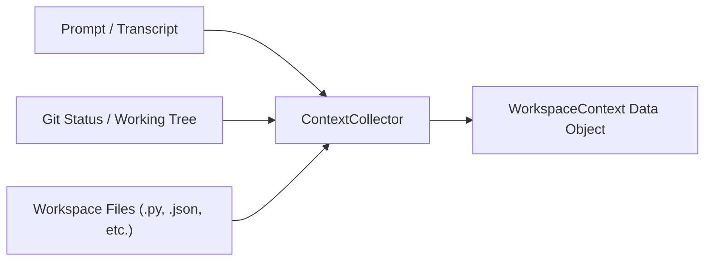
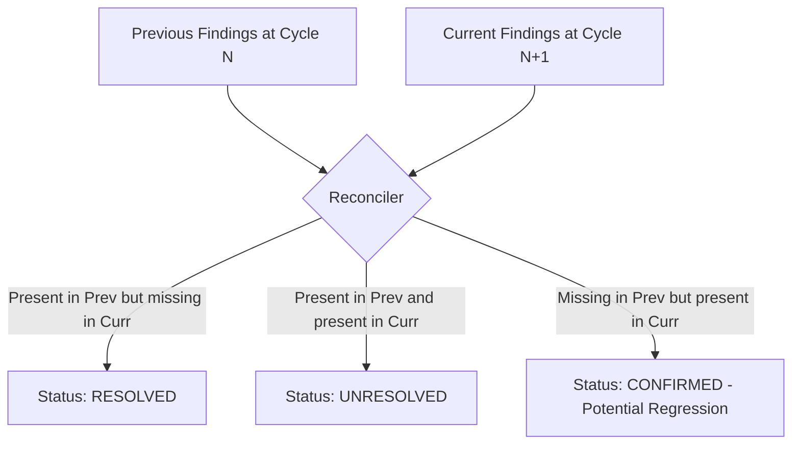

# SUPERVISOR Deterministic Review Engine Specification

## 1. Engine Objective & Design Principles

The **SUPERVISOR Review Engine** provides fast, deterministic, evidence-based code analysis without requiring paid LLM APIs or cloud dependencies. 

### Core Design Rules:
1. **Zero Fabrication**: Never claim a test, security audit, or command ran unless it actually executed.
2. **Deterministic Evidence**: Findings must be supported by concrete source lines, AST nodes, compiler outputs, or test failure tracebacks.
3. **Secret Redaction**: Detected API keys and credentials must be masked (`[REDACTED]`) before appearing in reports.
4. **Context Integrity**: Never invent requirements when the original prompt is missing; analyze available diffs against general coding and security standards.
5. **No Destructive Operations**: The engine is strictly non-destructive. It reads files and runs tests in isolated read/execution sub-processes without altering user work.

---

## 2. Context Extraction & Requirement Parsing

The engine ingests task and workspace context via the `ContextCollector`:



### A. Requirement Sources (Prioritized):
1. **Explicit Prompt**: Passed directly via CLI `--prompt` or task specification file `.supervisor/state.json`.
2. **Transcript Extraction**: Discovered by traversing platform log directories (e.g., `~/.gemini/antigravity/brain/<id>/.system_generated/logs/transcript.jsonl`) to locate the latest `USER_INPUT` message.
3. **Fallback Mode**: When the prompt is completely unavailable, SUPERVISOR records `task_spec: "UNAVAILABLE"`, generates an informational notice, and evaluates changes strictly against structural syntax, security vulnerabilities, and test suite execution. It does **not** hallucinate user requirements.

### B. Requirement Parser:
* Extracts bulleted (`*`, `-`) and numbered (`1.`, `2.`) criteria.
* Identifies imperative directives (`must`, `should`, `ensure`, `verify`, `implement`).
* Extracts explicit identifiers enclosed in backticks (e.g., `auth_token.py`, `UserService`) to verify artifact creation.

### C. Workspace & Git Inspection:
* Executes `git status --porcelain` to identify modified (`M`), added (`A`), and untracked (`?`) files.
* Executes `git diff HEAD` (or `git diff` for initial commits) to isolate exact changed lines.
* Excludes binary files, virtual environments (`.venv`, `node_modules`), cache folders (`__pycache__`), and `.supervisor/` runtime files.

---

## 3. Language Inspection Adapters (Static & AST Analysis)

The engine utilizes modular language inspectors:

### A. Python Inspector (`PythonLanguageAdapter`)
* **Syntax Validation**: Parses source content via Python standard library `ast.parse`. Captures `SyntaxError` with line, column, and error message.
* **Dangerous Call Detection**:
  * Calls to `eval()` or `exec()`: Severity `CRITICAL`, Category `SECURITY`.
  * Calls to `subprocess` with `shell=True`: Severity `HIGH`, Category `SECURITY`.
  * Insecure temporary file creation (`tempfile.mktemp`): Severity `HIGH`, Category `SECURITY`.
* **Error Handling & Exception Swallowing**:
  * Bare `except:` or `except (Exception, BaseException): pass` blocks containing only `pass` without logging or re-raising: Severity `MEDIUM`, Category `ERROR_HANDLING`.
* **Placeholder & Incomplete Implementation**:
  * Context-aware detection of `raise NotImplementedError` in non-abstract methods (skipping classes decorated with `abc.abstractmethod`): Severity `HIGH`, Category `MISSING_REQUIREMENT`.

### B. Structured Configuration Inspector (`ConfigLanguageAdapter`)
* **JSON Validation**: Parses via `json.loads`. Captures exact decode errors, lines, and columns.
* **YAML Validation**: When YAML parsers (`yaml` or safe regex fallback) are available, inspects configuration formatting.
* **TOML Validation**: Parses `pyproject.toml` and other TOML configurations via `tomllib` (Python 3.11+).

### C. JavaScript / TypeScript Inspector (`JsLanguageAdapter`)
* Evaluates syntax and common antipatterns (`eval()`, `new Function()`, hardcoded secrets) via AST/regex pattern matching.

---

## 4. Security & Credential Scanning

Scans all modified and newly created files for leaked credentials:

### A. High-Confidence Pattern Matching:
* **Private Key Blocks**: `-----BEGIN (RSA|EC|OPENSSH) PRIVATE KEY-----` (Severity: `CRITICAL`).
* **High-Entropy Secret Assignments**: Variable names matching `(?i)(api_key|secret|token|password|auth_token)` assigned strings of length $\ge 16$ with mixed alphanumeric characters (Severity: `CRITICAL`).
* **Known Cloud Prefixes**: `sk_live_`, `ghp_`, `AKIA[0-9A-Z]{16}` (Severity: `CRITICAL`).

### B. Redaction & Safety Rule:
* **Zero Secret Leakage in Reports**: The report generator masks the secret:
  ```text
  Evidence: API_KEY = "sk_live_********************"
  ```
  Reports never persist unmasked credential values to disk or logs.

---

## 5. Test Discovery & Execution Engine

SUPERVISOR enforces an evidence-based test runner that distinguishes genuine test results from syntax checks.

### A. Execution States:
* **`PASSED`**: Test command executed and exited with return code `0`.
* **`FAILED`**: Test command executed and returned non-zero exit code.
* **`NOT_RUN`**: Test suite exists but was skipped due to fast-path hook timeout constraints.
* **`NOT_AVAILABLE`**: No test runner or test files exist in the repository.
* **`BLOCKED`**: Test execution failed due to environment permissions, missing binaries, or unmet external dependencies.
* **`PARTIAL`**: Some configured test suites passed, but others failed or timed out.

### B. Test Runner Discovery Heuristics:
1. **Python**: Checks for `tests/` directory or `test_*.py` files. Discovers `pytest` or falls back to `python -m unittest discover -s tests`.
2. **Node.js**: Checks `package.json` for `"test"` script in `"scripts"`. If present, runs `npm test`.
3. **Explicit Command**: CLI flag `--test-cmd "<custom command>"`.

### C. Subprocess Sandboxing & Execution Constraints:
* **Safe Argument Splitting**: Always splits arguments via `shlex.split` and executes with `shell=False` to prevent command injection.
* **Command Timeout**: Default ` per_test_timeout_sec = 60 ` (configurable).
* **Buffer Truncation**: Stdout and stderr are capped at 4,000 characters to prevent memory exhaustion and giant log bloat.

---

## 6. Finding Data Model & Classification

### A. Severity Levels:
* **`CRITICAL`**: Flaws causing catastrophic failure or security exposure (e.g., SyntaxError preventing execution, hardcoded private keys, arbitrary code execution `eval`). Blocks task completion immediately.
* **`HIGH`**: Functional defects, failing test suites, or missing core requirements (e.g., test failure, unimplemented non-abstract function, command injection vulnerability). Blocks task completion.
* **`MEDIUM`**: Dangerous error handling, silent exception swallowing, or missing test suites for substantial code additions. Blocks task completion unless explicitly waived.
* **`LOW`**: Code quality defects, unused imports, or style violations that do not affect runtime correctness. Non-blocking recommendation.
* **`INFO`**: Informational notices (e.g., test runner not available, prompt context missing). Non-blocking.

### B. Material Finding Definition:
A finding is classified as **material** (requiring repair before task completion) if:
$$\text{Material} \iff \text{Severity} \in \{\text{CRITICAL}, \text{HIGH}, \text{MEDIUM}\} \land \text{Status} \in \{\text{CONFIRMED}, \text{UNRESOLVED}\}$$

### C. Categories:
* `BUG`: Incorrect logic, broken behavior, syntax error, or test failure.
* `MISSING_REQUIREMENT`: Required feature or artifact omitted.
* `REGRESSION`: Previously working functionality or tests broken by recent changes.
* `SECURITY`: Vulnerabilities, injection risks, or credential exposure.
* `ERROR_HANDLING`: Silent failure, bare except, or missing error boundaries.
* `DEPENDENCY_CONFIG`: Malformed configuration, missing dependencies.
* `INTEGRATION`: Incompatible interfaces between modules.
* `TESTING`: Inadequate, failing, or missing test suites.
* `PERFORMANCE`: Unbounded loops or high-risk resource exhaustion.
* `SPEC_MISMATCH`: Code differs materially from user specifications.

---

## 7. Finding Reconciliation Across Cycles

When moving from Cycle $N$ to Cycle $N+1$, findings are reconciled:



* **Deduplication**: Findings are identified by stable hash keys (`category + file_path + lineno + rule_type`).
* **Regression Detection**: Any material finding appearing in Cycle $N+1$ that was not present in Cycle $N$ is explicitly flagged as a **REGRESSION** introduced by the repair attempt.

---

## 8. Implemented Core Engine Architecture (Prompt 4 Status)

The shared core review engine has been implemented with zero third-party dependencies using standard library Python 3.11+:

| Module | Core Responsibility | Supported Checks & Features |
| :--- | :--- | :--- |
| `supervisor.models` | Data models & state | `Finding`, `SupervisorReport`, `CheckRecord`, `TestResult`, `TaskSpec`, `Severity`, `Category`, `Confidence`, `FindingStatus`, `TestStatus`, `ReviewStatus` |
| `supervisor.security` | Credentials & dangerous calls | Private keys (`RSA`, `EC`, `OPENSSH`), cloud tokens (`ghp_`, `sk_live_`, `AKIA`), generic credential assignments, `eval`/`exec`, `subprocess(shell=True)`, `tempfile.mktemp`, false-positive inline suppressions (`# supervisor:ignore`, `# nosec`), and mandatory secret masking via `redact_secret()` |
| `supervisor.inspector` | Syntax, AST & placeholders | Python AST parser (`ast.parse`), bare/silent exception swallowing, non-abstract `NotImplementedError`, empty stub function detection, JSON decoder (`json.loads`), TOML parser (`tomllib`), actionable `TODO`/`FIXME` markers |
| `supervisor.runner` | Test discovery & execution | Discovers `unittest` (`tests/` or workspace files) and `npm test` (`package.json`); enforces `shell=False` arg splitting, configurable timeout ceilings (default 30s), output truncation (4000 chars), script authorization policy, and honest `NOT_AVAILABLE` reporting without fabrication |
| `supervisor.context` | Workspace & task context | Git working tree analysis (`git status`, `git diff`), non-git directory traversal, 1 MB per-file reading limits, transcript prompt extraction, and missing-prompt `UNAVAILABLE` fallback |
| `supervisor.reviewer` | Review engine coordinator | Ingests context, executes language & security inspectors, executes test runners, tracks `checks_executed` / `checks_skipped` / `limitations`, reconciles previous findings, and produces structured `SupervisorReport` |
| `supervisor.reporter` | Structured reporting | Formats Markdown and JSON reports with executive summaries, check records, test statuses, confidence ratings, and redacted evidence |


