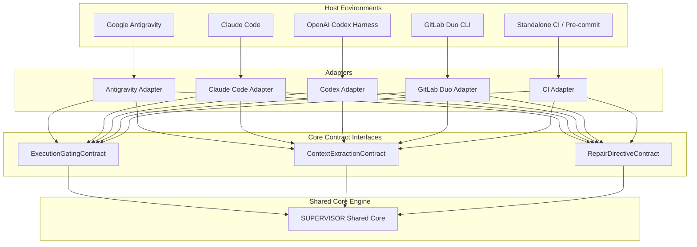

# SUPERVISOR Platform Integration Contract & Portability Architecture

## 1. Portability Philosophy: Shared Core + Platform Adapters

SUPERVISOR enforces an absolute architectural boundary:
* **The Shared Core (`supervisor/`)** contains 100% of the review logic, AST parsers, security rules, test runners, finding reconciler, state management, and report formatters. It has **zero dependencies** on Antigravity or any proprietary vendor SDK.
* **Platform Adapters (`supervisor/adapters/<platform>/`)** translate host-specific events, lifecycle hooks, slash commands, and agent communication channels into standardized Core interface calls.



---

## 2. Standard Adapter Interface Contracts

Any platform adapter must implement or map to the following three contracts:

### A. `ExecutionGatingContract`
Responsible for intercepting the completion event and deciding whether the agent is allowed to stop:

```python
class ExecutionGatingContract(abc.ABC):
    @abc.abstractmethod
    def intercept_completion(self, context_payload: dict) -> GatingDecision:
        """
        Evaluates whether the agent may conclude its turn.
        Returns:
            GatingDecision(
                allow_stop=True|False,
                continuation_payload=Optional[str],
                reason=str
            )
        """
        pass
```

### B. `ContextExtractionContract`
Responsible for retrieving the original task prompt, active files, and workspace metadata:

```python
class ContextExtractionContract(abc.ABC):
    @abc.abstractmethod
    def extract_task_prompt(self, host_context: dict) -> Optional[str]:
        """Discovers the original user prompt from host logs, transcripts, or env."""
        pass

    @abc.abstractmethod
    def get_workspace_root(self) -> Path:
        """Returns the canonical root directory of the workspace."""
        pass
```

### C. `RepairDirectiveContract`
Responsible for injecting actionable repair instructions back into the active agent:

```python
class RepairDirectiveContract(abc.ABC):
    @abc.abstractmethod
    def inject_repair_directive(self, directive_markdown: str) -> bool:
        """
        Passes repair instructions to the agent without waiting for user prompting.
        Returns True if autonomous handoff succeeded.
        """
        pass
```

---

## 3. Four-Platform Capabilities & Evidence Matrix

The table below summarizes the four implemented platform integrations, their completion enforcement models, and verified evidence levels based on the rigorous 6-tier validation taxonomy:

* **Level 1 (Implemented)**: Adapter, CLI hook handler, and project configuration exist.
* **Level 2 (Unit-tested)**: Individual adapter components and input parsers pass automated tests.
* **Level 3 (Subprocess-tested)**: Real CLI hook executables and lifecycle cycles execute successfully in unmocked subprocesses.
* **Level 4 (Documentation-verified)**: Hook event names, stdin/stdout/stderr contracts, and exit codes verified against official platform specifications.
* **Level 5 (Live-host-tested)**: Verified directly in the actual coding-agent host environment.
* **Level 6 (Automatic repair demonstrated)**: The actual coding agent receives the defect finding, modifies the code without a new user prompt, and triggers a successful subsequent review.

| Platform | Hook Mechanism | Blocking Protocol | Level 1: Impl | Level 2: Unit | Level 3: Subprocess | Level 4: Docs | Level 5: Host | Level 6: Auto-Repair Demo | Status & Limitations |
| :--- | :--- | :--- | :--- | :--- | :--- | :--- | :--- | :--- | :--- |
| **Google Antigravity** | `.agents/hooks.json` (`Stop`) | `decision: "continue"` | **YES** | **YES** (15 tests) | **YES** (`test_real_lifecycle_fixture.py`) | **YES** (Built-in AGY docs) | **YES** (Verified in AGY session) | **YES** (Demonstrated in Prompt 6) | **Production Verified** in Google Antigravity. |
| **OpenAI Codex** | `.codex/hooks.json` (`Stop`) | `decision: "block"` / Exit 2 | **YES** | **YES** (14 tests) | **YES** (`test_codex_real_lifecycle_fixture.py`) | **YES** (Codex CLI docs) | *Simulated* | *Simulated* | Fully verified via unmocked subprocess; live cloud execution requires API key. |
| **Claude Code** | `.claude/settings.json` (`Stop`) | `decision: "block"` / Exit 2 | **YES** | **YES** (16 tests) | **YES** (`test_claude_code_real_lifecycle_fixture.py`) | **YES** (Claude settings docs) | *Simulated* | *Simulated* | Fully verified via unmocked subprocess; external binary invocation requires host CLI. |
| **GitLab Duo CLI** | `.gitlab/duo/hooks.json` (`Stop`) | Exit code 2 on stderr | **YES** | **YES** (16 tests) | **YES** (`test_gitlab_duo_real_lifecycle_fixture.py`) | **YES** (GitLab Duo CLI docs) | *Simulated* | *Simulated* | Fully verified via unmocked subprocess; live GitLab GUI requires Duo seat. |


---

## 4. Platform Adapter Implementations

### A. Google Antigravity (`supervisor/adapters/antigravity.py`)
* **Hook Mechanism**: Native `Stop` hook configured in `.agents/hooks.json`.
* **Handoff Mechanism**: Emits `{"decision": "continue", "reason": "<directives>"}` on `stdout` with exit code `0`.
* **Context**: Reads Antigravity camelCase JSON payload (`terminationReason`, `workspacePaths`, `transcriptPath`).
* **Command & Instructions**: `/supervisor` skill in `.agents/skills/supervisor/SKILL.md`, `GEMINI.md`, and `AGENTS.md`.

### B. OpenAI Codex (`supervisor/adapters/codex.py`)
* **Hook Mechanism**: Project-level `Stop` hook in `.codex/hooks.json` and program loop harness.
* **Handoff Mechanism**: Emits `{"decision": "block", "reason": "<directives>"}` or exit code `2` with `stderr` feedback.
* **Context**: Reads `cwd`, `session_id`, `stop_hook_active`, `last_assistant_message`.
* **Instructions**: `.codex/AGENTS.md` and repository root `AGENTS.md`.

### C. Claude Code (`supervisor/adapters/claude_code.py`)
* **Hook Mechanism**: Project settings hook in `.claude/settings.json`.
* **Handoff Mechanism**: Supports default structured JSON `decision: "block"` and imperative exit code `2` on `stderr`.
* **Context**: Reads `transcript_path`, `cwd`, `session_id`, and `last_assistant_message`.
* **Command & Instructions**: Custom command `.claude/commands/supervisor.md` and `CLAUDE.md`.

### D. GitLab Duo CLI (`supervisor/adapters/gitlab_duo.py`)
* **Hook Mechanism**: Project-level native hook in `.gitlab/duo/hooks.json`.
* **Handoff Mechanism**: Defaults to imperative exit code `2` with actionable markdown directives on `stderr`. Supports structured JSON stdout mode with `--json-block` or `SUPERVISOR_GITLAB_JSON_BLOCK=1`.
* **Context**: Ingests JSON payload via `stdin` (`cwd`, `session_id`, `hook_event_name`, `last_assistant_message`) and environment variables `DUO_PROJECT_DIR` and `DUO_SESSION_ID`.
* **Command & Instructions**: Custom slash command `.gitlab/duo/commands/supervisor.md` and `.gitlab/duo/chat-rules.md`.


---

## 5. Implemented Antigravity Integration (Prompt 5 Status)

The native Google Antigravity integration is fully implemented through a decoupled, multi-layered architecture:

### A. Architectural Components:
1. **Lifecycle Hook Configuration (`.agents/hooks.json`)**:
   - Registers a `Stop` event handler targeting `python -m supervisor.hooks.stop_hook` with a bounded timeout (`timeout: 60`).
2. **Thin Adapter (`supervisor/adapters/antigravity.py`)**:
   - Encapsulates `AntigravityAdapter`.
   - Ingests Antigravity camelCase JSON payloads on `stdin` (`terminationReason`, `workspacePaths`, `transcriptPath`, etc.).
   - Evaluates terminal states, recursion guards, and zero-progress states.
   - Delegates inspection and verification to `SupervisorOrchestrator` without duplicating review logic.
   - Enforces credential redaction via `SecurityInspector.redact_secret()` on all outgoing JSON directives.
   - Emits compliant `{"decision": "continue", "reason": "<directives>"}` or `{"decision": "allow", "reason": "..."}`.
3. **Skill & Slash Command (`.agents/skills/supervisor/SKILL.md`)**:
   - Provides `/supervisor` entry point with default Review -> Auto-Repair Handoff -> Verify workflow.
   - Supports explicit `--report-only` flag when repair directives should not be dispatched.
4. **Persistent Project Instructions (`GEMINI.md`, `AGENTS.md`, `.agents/rules/AGENTS.md`)**:
   - Enforces the core mandate and autonomous defect repair protocol without waiting for user instruction.
   - Mandates non-destructive repairs and preservation of unrelated user code.

### B. Confirmed vs. Mocked Verification:
* **Hook Payload Parsing & Output Formatting**: Confirmed via 15 comprehensive automated integration tests in `tests/test_antigravity_integration.py`.
* **Autonomous Continuation Schema**: Confirmed against the official Antigravity built-in documentation (`<appDataDir>/builtin/skills/agy-customizations/docs/hooks.md`).
* **Secret Redaction**: Confirmed with automated tests verifying that tokens (`sk_live_`, `ghp_`, private keys) are masked before returning in the hook's JSON `reason` payload.


