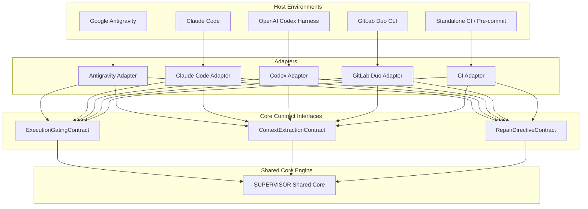

# SUPERVISOR Platform Integration Contract & Portability Architecture

## 1. Portability Philosophy: Shared Core + Platform Adapters

SUPERVISOR enforces an absolute architectural boundary:
* **The Shared Core (`supervisor/`)** contains 100% of the review logic, AST parsers, security rules, test runners, finding reconciler, state management, and report formatters. It has **zero dependencies** on Antigravity or any proprietary vendor SDK.
* **Platform Adapters (`supervisor/adapters/<platform>/`)** translate host-specific events, lifecycle hooks, slash commands, and agent communication channels into standardized Core interface calls.



---

## 2. Standard Adapter Interface Contracts

Any platform adapter must implement or map to the following three contracts:

### A. `ExecutionGatingContract`
Responsible for intercepting the completion event and deciding whether the agent is allowed to stop:

```python
class ExecutionGatingContract(abc.ABC):
    @abc.abstractmethod
    def intercept_completion(self, context_payload: dict) -> GatingDecision:
        """
        Evaluates whether the agent may conclude its turn.
        Returns:
            GatingDecision(
                allow_stop=True|False,
                continuation_payload=Optional[str],
                reason=str
            )
        """
        pass
```

### B. `ContextExtractionContract`
Responsible for retrieving the original task prompt, active files, and workspace metadata:

```python
class ContextExtractionContract(abc.ABC):
    @abc.abstractmethod
    def extract_task_prompt(self, host_context: dict) -> Optional[str]:
        """Discovers the original user prompt from host logs, transcripts, or env."""
        pass

    @abc.abstractmethod
    def get_workspace_root(self) -> Path:
        """Returns the canonical root directory of the workspace."""
        pass
```

### C. `RepairDirectiveContract`
Responsible for injecting actionable repair instructions back into the active agent:

```python
class RepairDirectiveContract(abc.ABC):
    @abc.abstractmethod
    def inject_repair_directive(self, directive_markdown: str) -> bool:
        """
        Passes repair instructions to the agent without waiting for user prompting.
        Returns True if autonomous handoff succeeded.
        """
        pass
```

---

## 3. Platform Capabilities & Adapter Assessment

| Platform | Automatic Triggering | Repair Handoff | Completion Enforcement | Implementation Mechanism | Support Status |
| :--- | :--- | :--- | :--- | :--- | :--- |
| **Google Antigravity** | `Stop` hook in `.agents/hooks.json` | `decision: "continue"` with `reason` string | **Hard Gating**: Hook blocks turn completion | Native lifecycle hook + Skill + AGENTS.md | **Documented & Tested** |
| **Claude Code** | Pre-prompt / bash tool wrappers or hooks | Tool output injection or stdin injection | **Hard Gating**: Non-zero exit code halts completion | CLI hook / custom tool wrapper | **Plausible (Requires Testing)** |
| **OpenAI Codex** | `Stop` hook in `.codex/hooks.json` & Harness wrapper | `decision: "block"` / exit code 2 with directives | **Hard Gating**: Hook intercepts turn / API loop continuation | `CodexAdapter` + `.codex/hooks.json` + `AGENTS.md` | **Implemented & Tested** |
| **GitLab Duo CLI** | Pipeline trigger or Duo CLI hook | Duo chat message / pipeline notification | **Soft Gating**: Fails MR pipeline check | CI job / Git hook (`pre-push`) | **Plausible (MR Gate)** |
| **Standalone CI (GitHub Actions)**| `on: [push, pull_request]` | Annotations / PR comments / CLI failure | **Hard Gating**: Fails workflow exit code 1 | GitHub Actions runner `python -m supervisor review` | **Documented & Tested** |

---

## 4. Detailed Specification of Future Adapters

### A. Claude Code Adapter (`supervisor/adapters/claude_code/`)
* **Hook Mechanism**: Claude Code supports lifecycle shell integration and tool interception via project settings.
* **Handoff Mechanism**: Emits formatted repair markdown on stderr/stdout with exit code 1, forcing Claude Code to read the failure output and propose repairs.
* **Pre-requisite Research**: Verify exact JSON-RPC tool-use interception in the latest Claude Code CLI releases.

### B. OpenAI Codex Harness Adapter (`supervisor/adapters/codex/`)
* **Harness Model**: Since Codex is typically accessed programmatically via agent orchestration frameworks (e.g. OpenAI Assistants API or custom agent loops), the adapter acts as an execution decorator around `client.beta.threads.runs.create_and_poll`.
* **Handoff Mechanism**: If SUPERVISOR returns `FIXES_REQUIRED`, the decorator automatically appends the repair directive to the thread and triggers a new run.

### C. Standalone CI Adapter (`supervisor/adapters/ci/`)
* **Execution**: Executed directly in GitHub Actions or GitLab CI runners:
  ```yaml
  - name: Run SUPERVISOR Review
    run: python -m supervisor review --format markdown
  ```
* **Output**: Writes summary to `$GITHUB_STEP_SUMMARY` and posts PR review comments via GitHub API.
* **Gating**: Exits with status `1` on material defects, blocking PR merge.

---

## 5. Implemented Antigravity Integration (Prompt 5 Status)

The native Google Antigravity integration is fully implemented through a decoupled, multi-layered architecture:

### A. Architectural Components:
1. **Lifecycle Hook Configuration (`.agents/hooks.json`)**:
   - Registers a `Stop` event handler targeting `python -m supervisor.hooks.stop_hook` with a bounded timeout (`timeout: 60`).
2. **Thin Adapter (`supervisor/adapters/antigravity.py`)**:
   - Encapsulates `AntigravityAdapter`.
   - Ingests Antigravity camelCase JSON payloads on `stdin` (`terminationReason`, `workspacePaths`, `transcriptPath`, etc.).
   - Evaluates terminal states, recursion guards, and zero-progress states.
   - Delegates inspection and verification to `SupervisorOrchestrator` without duplicating review logic.
   - Enforces credential redaction via `SecurityInspector.redact_secret()` on all outgoing JSON directives.
   - Emits compliant `{"decision": "continue", "reason": "<directives>"}` or `{"decision": "allow", "reason": "..."}`.
3. **Skill & Slash Command (`.agents/skills/supervisor/SKILL.md`)**:
   - Provides `/supervisor` entry point with default Review -> Auto-Repair Handoff -> Verify workflow.
   - Supports explicit `--report-only` flag when repair directives should not be dispatched.
4. **Persistent Project Instructions (`GEMINI.md`, `AGENTS.md`, `.agents/rules/AGENTS.md`)**:
   - Enforces the core mandate and autonomous defect repair protocol without waiting for user instruction.
   - Mandates non-destructive repairs and preservation of unrelated user code.

### B. Confirmed vs. Mocked Verification:
* **Hook Payload Parsing & Output Formatting**: Confirmed via 15 comprehensive automated integration tests in `tests/test_antigravity_integration.py`.
* **Autonomous Continuation Schema**: Confirmed against the official Antigravity built-in documentation (`C:\Users\DELL\.gemini\antigravity\builtin\skills\agy-customizations\docs\hooks.md`).
* **Secret Redaction**: Confirmed with automated tests verifying that tokens (`sk_live_`, `ghp_`, private keys) are masked before returning in the hook's JSON `reason` payload.


