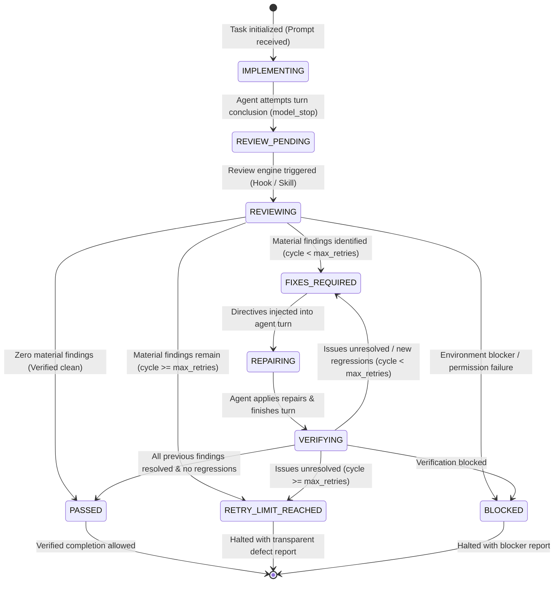
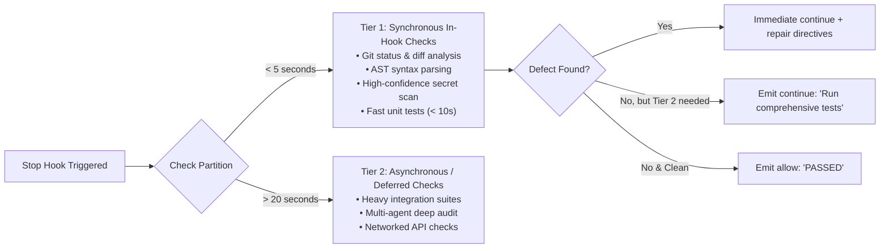

# SUPERVISOR Lifecycle State Machine & Timeout Strategy

## 1. The 9 Lifecycle States

SUPERVISOR implements a formal Finite State Machine (FSM) to ensure deterministic loop control, prevent infinite recursion, and govern task completion.

---

## 2. Complete State Transition Table

| Current State | Trigger Event | Precondition | Action Taken | Next State |
| :--- | :--- | :--- | :--- | :--- |
| `IMPLEMENTING` | Turn conclusion | `terminationReason == "model_stop"` | Intercepted by `Stop` hook; queues review. | `REVIEW_PENDING` |
| `REVIEW_PENDING`| Review dispatched | State file unlocked | Runs fast deterministic checks & tests. | `REVIEWING` |
| `REVIEWING` | Checks complete | Material findings $== 0$ | Persists report; marks verified. | `PASSED` |
| `REVIEWING` | Checks complete | Material findings $> 0 \land \text{cycle} < \text{max\_retries}$ | Generates repair directives; returns `decision: "continue"`. | `FIXES_REQUIRED` |
| `REVIEWING` | Checks complete | Material findings $> 0 \land \text{cycle} \ge \text{max\_retries}$ | Persists failure report; returns `decision: "allow"`. | `RETRY_LIMIT_REACHED` |
| `REVIEWING` | Execution failure| Test runner timeout or permissions error | Logs exact limitation; halts gating. | `BLOCKED` |
| `FIXES_REQUIRED`| Directives received| Agent loop active | Agent applies edits to target files. | `REPAIRING` |
| `REPAIRING` | Repairs concluded| `terminationReason == "model_stop"` | Increments cycle count ($N \to N+1$); starts verification. | `VERIFYING` |
| `VERIFYING` | Verification pass| Previous findings resolved $\land$ 0 regressions | Emits `decision: "allow"` with PASSED summary. | `PASSED` |
| `VERIFYING` | Verification fail| Unresolved findings $\land \text{cycle} < \text{max\_retries}$ | Formulates delta repair directives; returns `decision: "continue"`. | `FIXES_REQUIRED` |
| `VERIFYING` | Retry exhausted | Unresolved findings $\land \text{cycle} \ge \text{max\_retries}$ | Emits `decision: "allow"` with detailed list of remaining defects. | `RETRY_LIMIT_REACHED` |

---

## 3. Loop Safety & Recursion Prevention

To guarantee that SUPERVISOR never falls into an infinite review loop or triggers itself recursively:

1. **Configurable Retry Ceiling**:
   - Default: `max_retries = 3`.
   - The cycle counter is monotonically incremented only upon entering `VERIFYING`.
   - Once $\text{cycle} \ge \text{max\_retries}$, transition to `RETRY_LIMIT_REACHED` is mandatory. The hook **must emit `decision: "allow"`**, halting autonomous loop re-entry.
2. **Recursive Interception Guard**:
   - If a tool executed by SUPERVISOR itself triggers an event, the hook detects the process lock and exits immediately with `decision: "allow"`.
3. **No Duplicate Reviews**:
   - Atomic file locking on `.supervisor/lock` ensures that multiple concurrent events cannot evaluate the workspace simultaneously.
4. **No Spurious Retries on Stale Code**:
   - If `git diff` between Cycle $N$ and Cycle $N+1$ is completely empty (i.e. the agent made zero edits), SUPERVISOR halts the cycle immediately, reporting that no repair attempts were made.

---

## 4. Hook Execution Timeout Strategy

In Google Antigravity, lifecycle hooks execute synchronously on the host event loop. Hook timeouts default to **30 seconds** (configurable up to 120s in `.agents/hooks.json`). Exceeding this timeout results in process termination.

### A. Two-Tiered Execution Partitioning:

### B. What Safely Runs Synchronously in the Hook:
* Git diff extraction: $\approx 10\text{–}50\text{ ms}$.
* AST syntax & security analysis: $\approx 50\text{–}200\text{ ms}$.
* Fast unit tests (e.g. `python -m unittest` with $< 50$ tests): $\approx 500\text{ ms – }3\text{ s}$.
* Report and directive generation: $\approx 20\text{ ms}$.
* **Total Hook Execution Time**: Typically under **3.5 seconds**.

### C. Handling Long-Running Test Suites:
If a repository contains extensive end-to-end or integration test suites exceeding 20 seconds:
1. **Never run unbounded tests inside the hook**: Subprocess execution inside `stop_hook` enforces a strict timeout: `per_test_timeout_sec = 15`.
2. **Interrupted Execution Handling**:
   - If a test command times out during the hook, it is recorded as `status: "BLOCKED"` with message: `"Test execution exceeded synchronous hook timeout (15s)."`.
   - The hook does **not** assume the test passed. It emits `decision: "continue"` with an instruction to the coding agent:
     `"The comprehensive test suite timed out in the supervisor gate. Please run and verify tests directly in the terminal before concluding."`
3. **Never Fabricate Success**: A timed-out or interrupted test is never marked `PASSED`.

