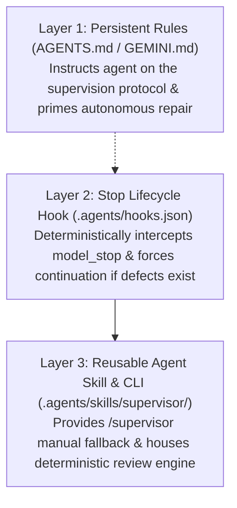

# SUPERVISOR Research Executive Summary

## 1. Overview
This research investigated Google Antigravity's actual supported capabilities to determine how to integrate **SUPERVISOR**—an AI coding supervision and automatic repair system—into the agent's execution lifecycle.

---

## 2. Key Findings

### A. What Antigravity Reliably Supports
1. **Deterministic Termination Interception via `Stop` Hook**:
   - The [`Stop` Lifecycle Hook](../antigravity/hooks-and-lifecycle.md#4-deep-dive-the-stop-hook-contract) in `.agents/hooks.json` reliably intercepts `terminationReason: "model_stop"`.
   - Returning `{"decision": "continue", "reason": "<repair directives>"}` halts completion and deterministically forces the coding agent back into an active turn without requiring any user input.
2. **First-Class Slash Command & Skill Activation**:
   - Defining a skill with `name: supervisor` in [`.agents/skills/supervisor/SKILL.md`](../antigravity/skills.md#3-the-skillmd-file-specification) automatically provides the `/supervisor` command across the Chat Canvas, CLI, and IDE.
3. **Progressive Context Disclosure**:
   - Skills consume negligible context until activated, preserving token budgets during ordinary coding turns.
4. **Contextual Rule Enforcement**:
   - [`AGENTS.md` and `GEMINI.md`](../antigravity/rules-and-instructions.md#2-rule-locations--formats) persistently establish the agent's behavioral mandate and prepare it to comply with incoming repair directives.
5. **Multi-Agent Subagent Coordination**:
   - Antigravity natively provides tools (`invoke_subagent`, `define_subagent`, `send_message`, `manage_subagents`) for spinning up concurrent auditor agents.

---

### B. What is Possible but Requires Testing
1. **Multi-Agent Asynchronous Isolation Benchmark**:
   - While `invoke_subagent(Workspace="inherit")` is documented, running an independent subagent concurrently to inspect code adds latency and token consumption compared to a local Python CLI run. Benchmark testing is needed to determine when subagent auditing outperforms local AST inspection.
2. **Timeout Boundaries on Large Codebases**:
   - Hook executions default to 30 seconds (configurable up to 120s). Dynamic test runs on enterprise codebases must be carefully bounded to avoid hook timeouts.

---

### C. What CANNOT Currently Be Guaranteed by Platform Primitives Alone
1. **Supervision via Skills Alone**:
   - A skill *cannot* force itself to run at task completion. Without a lifecycle hook or rule, an agent will simply complete its turn without invoking the skill.
2. **Supervision via Rules Alone**:
   - Rules guide model behavior probabilistically, but *cannot* intercept the engine or prevent a model from emitting a `model_stop` token.
3. **Legacy Workflows**:
   - [Workflows are deprecated](../antigravity/workflows.md#1-executive-definition--deprecation-status). They cannot run automatically, cannot intercept completion, and cannot bundle scripts.

---

## 3. The Strongest Candidate Integration Mechanism

The optimal, highest-confidence architecture is a **Tri-Layer Hybrid Strategy**:

1. **Instructional Layer (`GEMINI.md` / `AGENTS.md`)**: Primes the model so it understands that code is never finished without verification and that it must fix defects immediately without prompting the user.
2. **Enforcement Layer (`.agents/hooks.json` on `Stop`)**: Acts as the physical gatekeeper. If the model attempts to finish with unresolved findings, the hook rejects the stop and injects actionable repair directives.
3. **Procedural Layer (`.agents/skills/supervisor/SKILL.md`)**: Serves as the manual slash-command entry point (`/supervisor`), containing the runbook and linking to deterministic analysis scripts.

---

## 4. Technical Risks & Mitigations

| Identified Risk | Impact | Mitigation Strategy |
| :--- | :--- | :--- |
| **Hook Timeout during Full Test Runs** | Hook terminates with exit status if tests exceed timeout. | The hook executes fast static checks and targeted unit tests. Long-running integration test suites are deferred or executed with explicit timeouts. |
| **Agent Infinite Repair Loops** | Agent repeatedly fails to fix a bug and cycles endlessly. | State manager enforces an immutable `max_retries = 3` counter. Once reached, state transitions to `RETRY_LIMIT_REACHED` and the hook allows completion with honest defect reporting. |
| **Sandboxed Environments without Hook Runner** | Hooks disabled in restricted environments. | Persistent rules instruct the agent to run `python -m supervisor review` directly, ensuring a probabilistic fallback when deterministic hooks are disabled. |

---

## 5. Key Questions to Resolve in Prompt 3

1. **Review Engine Scope**: Should the review engine rely exclusively on deterministic AST and static analysis, or also support LLM-assisted semantic diff evaluation?
2. **Subagent Delegation Policy**: At what threshold of task complexity should the orchestrator spin up an independent `supervisor-auditor` subagent rather than running the local Python inspector?
3. **State Storage Location**: Ensure `.supervisor/` remains cleanly git-ignored and portable across Windows, macOS, and Linux without file-locking issues.

