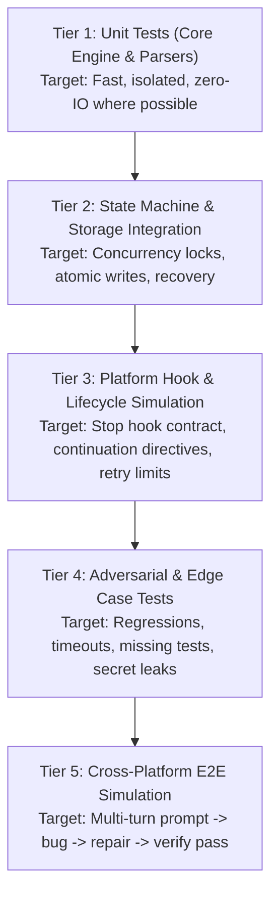

# SUPERVISOR Comprehensive Testing Strategy

## 1. Testing Philosophy & Verification Gate

SUPERVISOR operates on the mandate that software quality must be demonstrated through empirical evidence, never through assumptions. The testing suite itself must be subjected to this exact standard.

---

## 2. Test Tiers & Scope

### Tier 1: Core Engine Unit Tests (`tests/unit/`)
* **`test_inspector_ast.py`**:
  - Python syntax error parsing with exact line and column numbers.
  - Detection of `eval()` and `exec()` calls across functions and classes.
  - Detection of `subprocess` with `shell=True`.
  - Detection of bare `except:` and silent `except Exception: pass` blocks.
  - Context-aware `NotImplementedError` detection (skipping `@abstractmethod`).
* **`test_inspector_config.py`**:
  - Valid and invalid JSON syntax parsing.
  - TOML and YAML parsing error detection.
* **`test_security_scanner.py`**:
  - Private RSA and EC key detection.
  - High-entropy API key pattern matches.
  - Verification that secret values are replaced with `[REDACTED]` in reports.
* **`test_context_collector.py`**:
  - Extraction of prompt requirements from bulleted and numbered lists.
  - Fallback behavior when prompt is unavailable (no hallucinations).
  - Git status and diff parsing.

### Tier 2: State Machine & Concurrency Tests (`tests/integration/`)
* **`test_state_machine.py`**:
  - Transitions through all 9 states: `IMPLEMENTING` $\to$ `REVIEW_PENDING` $\to$ `REVIEWING` $\to$ `FIXES_REQUIRED` $\to$ `REPAIRING` $\to$ `VERIFYING` $\to$ `PASSED`.
  - Cycle count incrementing and transition to `RETRY_LIMIT_REACHED` when $\text{cycle} \ge \text{max\_retries}$.
  - Transition to `BLOCKED` on external environment barriers.
* **`test_file_locking.py`**:
  - Advisory file locking (`.supervisor/lock`) under multi-process contention.
  - Atomic rename (`os.replace`) ensuring zero file corruption on simulated crash.
  - Stale lock detection and automatic reclamation after timeout.

### Tier 3: Lifecycle Hook & Gating Tests (`tests/lifecycle/`)
* **`test_stop_hook_contract.py`**:
  - Hook ignores non-completion reasons (`user_cancelled`, `max_steps_exceeded`, `error`), returning `{"decision": "allow"}`.
  - Hook intercepts `model_stop` on unverified code, returning `{"decision": "continue", "reason": "<directives>"}`.
  - Hook permits exit when state is `PASSED` or `RETRY_LIMIT_REACHED`, returning `{"decision": "allow"}`.
  - Hook completes within $< 4.0$ seconds on representative repositories.

### Tier 4: Adversarial & Edge-Case Tests (`tests/edge_cases/`)
* **`test_missing_test_infrastructure.py`**:
  - Repository contains code files but no tests.
  - Verifies engine reports `status: "NOT_AVAILABLE"` or `status: "RECOMMENDED"`.
  - **Critical Invariant**: Engine **never** claims tests passed when no tests exist.
* **`test_test_runner_timeout.py`**:
  - Simulates an infinite loop or hanging test suite (`sleep 60`).
  - Verifies runner terminates after configured timeout (`per_test_timeout_sec`).
  - Verifies result is marked `status: "BLOCKED"` or `FAILED`, never `PASSED`.
* **`test_empty_workspace_diff.py`**:
  - Agent makes zero edits during a repair cycle.
  - Verifies engine detects zero code changes and halts to prevent infinite cycling.
* **`test_regression_detection.py`**:
  - Agent repairs Bug A, but introduces Bug B (e.g. syntax error or security flaw).
  - Verifies verification engine marks Bug A as `RESOLVED`, flags Bug B as a `REGRESSION`, and transitions to `FIXES_REQUIRED`.

### Tier 5: End-to-End Simulation Tests (`tests/e2e/`)
* **`test_e2e_full_lifecycle_pass.py`**:
  - Simulates Stage 1 through Stage 9:
    1. Task initialized: "Build token parser".
    2. Coder writes flawed code with `eval()`.
    3. Review flags `SEC-0001` (Critical).
    4. Auto-repair directives injected into agent turn.
    5. Agent replaces `eval()` with `json.loads()`.
    6. Verifier rechecks findings, confirms fix, and checks for regressions.
    7. Task marks `PASSED` with verified test execution.
* **`test_e2e_retry_limit_halting.py`**:
  - Agent repeatedly fails to fix a defect across 3 cycles.
  - Verifies cycle increments $1 \to 2 \to 3 \to \text{RETRY\_LIMIT\_REACHED}$.
  - Verifies final output states unresolved defects transparently and exits with status 1.

---

## 3. Verification & Acceptance Checklist

Before any implementation prompt is deemed complete, the following gates must be satisfied:

| Check | Requirement | Gate Tool |
| :---: | :--- | :--- |
| 1 | All unit and integration tests pass with 0 failures | `python -m unittest discover -s tests -v` |
| 2 | Code passes strict AST syntax check | `python -m py_compile` across all `.py` files |
| 3 | Zero unredacted secrets in test outputs or reports | Regex scan for raw API keys |
| 4 | No `shell=True` in subprocess calls | AST visit across `supervisor/` |
| 5 | Clean git working tree and git-ignored `.supervisor/` | `git status` |
| 6 | Dogfooding run passes verification cleanly | `python -m supervisor review` |

